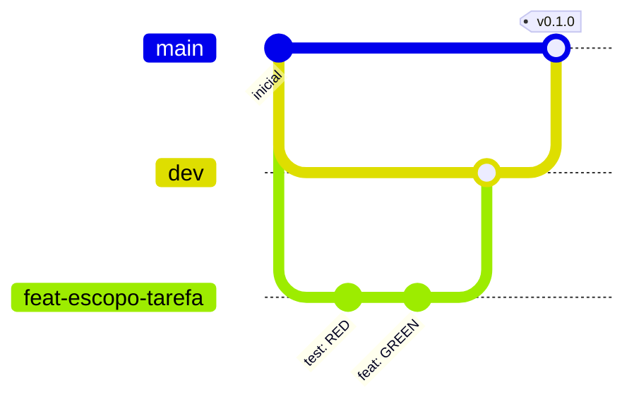

# Como contribuir

Vale para pessoas e agentes. O método do projeto está em `docs/method.md`; as regras de código, em `AGENTS.md`.

## Fluxo de trabalho

1. A mudança começa na spec (`docs/requirements/` ou `docs/features/…`), nunca no código.
2. Uma tarefa por vez, com TDD: teste falhando → código mínimo → refatoração → suíte completa verde.
3. Um ciclo verde = um commit.

## Branches

Modelo: `main` + `dev`

- `main`: só recebe merge com autorização explícita do dono; cada merge é uma versão demonstrável, e é dela que sai o
  deploy de produção.
- `dev`: branch de integração; toda feature nasce dela e volta para ela depois do checkpoint.
- Nome: `<tipo>/<escopo>-<descricao-curta>`, tudo minúsculo. Ex.: `feat/financeiro-validacao-de-pagamento`.



## Commits

Formato [Conventional Commits](https://www.conventionalcommits.org/pt-br/v1.0.0/):

```text
<tipo>(<escopo>): <assunto>

<corpo opcional: o quê e por quê, não como>

Refs: RF-NN
```

| Parâmetro | Regra |
| --- | --- |
| Tipos | `feat`, `fix`, `refactor`, `perf`, `test`, `docs`, `build`, `ci`, `chore`, `style`, `revert` |
| Escopos | `acesso`, `permissoes`, `auditoria`, `notificacoes`, `aprovacoes`, `financeiro`, `eventos`, `comunicacao`, `marca`, `relatorios`, `web`, `metodo`, `platform`, `deps`, `readme` — obrigatório |
| Assunto | Português, imperativo, minúsculo, sem ponto final, até 72 caracteres |
| Corpo | Quebra em 72–100 colunas; explica o porquê |
| Rodapé | `Refs: RF-NN`, `RNF-NN` ou `RN-NN` quando houver requisito; `BREAKING CHANGE: …` quando quebrar contrato |
| Trailers de IA | Não usar (sem `Co-Authored-By` de assistente) |

Os dez primeiros escopos são os módulos do desenho estratégico (`docs/domain/strategic-design.md`). `metodo` cobre os documentos do processo (`docs/method.md`, charter, registro de decisões);
`web` cobre o site; `platform` cobre Docker, CI, configuração e deploy.

Exemplos:

```text
test(aprovacoes): cobrir recusa quando o solicitante tenta aprovar o próprio pedido
feat(aprovacoes): impedir que o solicitante aprove o próprio pedido sem permissão
fix(financeiro): não gerar cobrança recorrente para diretor desativado
docs(metodo): registrar decisão de estilo de arquitetura
```

## Pull requests

- O modelo não exige PR. A checklist de `.github/pull_request_template.md` é conferida antes de cada merge na `dev`
  e na `main`; se um PR for aberto, ele usa esse template.
- Solo: checklist de auto-revisão conferida antes do merge.
- Título do PR no mesmo formato de commit.
- Merge: merge commit, para preservar um commit por ciclo verde; a branch é apagada depois.

## Versões

Tag SemVer na `main` a cada entrega (`v<major>.<minor>.<patch>`). Enquanto a etapa 1 não estiver em produção, as
versões são `v0.<n>.0`, uma por marco concluído; a `v1.0.0` é o M12 no ar.

## Nunca

- Commitar segredos, `.env`, credenciais ou dados pessoais reais.
- Alterar testes ou a spec só para o build passar.
- Fazer push ou merge na `main` sem autorização.
- Commitar `docs/_local/` (notas e histórico bruto, fora do git).
