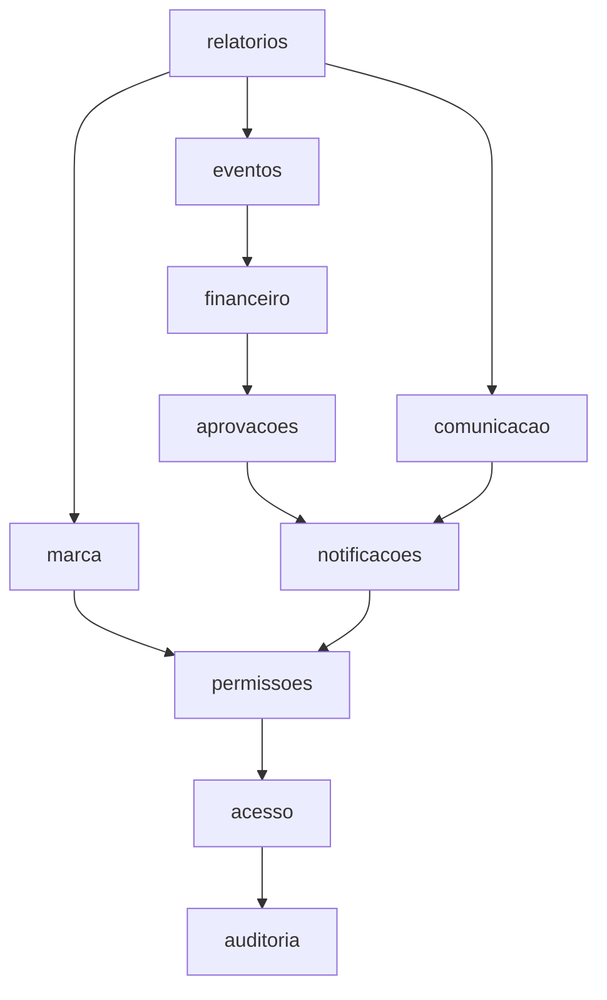
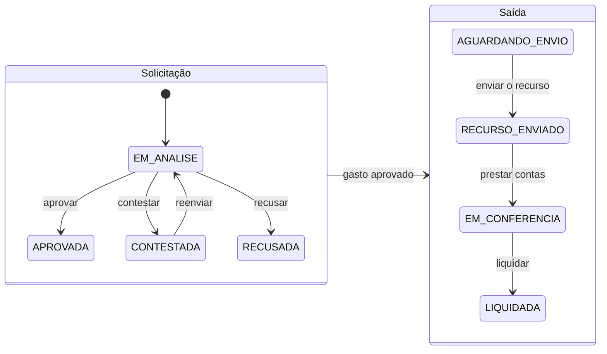

# Club Manager

Sistema de governança financeira e institucional de um time de futebol, usado pelos diretores: controle de entradas e
saídas, aprovação formal de gastos e eventos, e rastreabilidade de quem fez o quê e quando.

Os valores são escriturais: o sistema registra, e o dinheiro se move por fora, na conta do clube.

## Como rodar

Precisa de Docker Desktop, uv e Node 22. No Windows, rode os comandos num terminal aberto em `C:\…` com a letra
maiúscula.

```text
cd backend
uv sync
uv run python scripts/make_env.py
cd ..
docker compose up --build
```

`make_env.py` cria o `.env` com segredos aleatórios; as variáveis estão descritas em `.env.example`. O site abre em
<http://localhost:8080>, na tela de entrar. O primeiro admin é criado com
`docker compose exec api python manage.py criar_admin`, e ele convida os demais diretores.

Para rodar só os testes, suba o banco e o Redis com `docker compose up -d db redis` e use `127.0.0.1` (e não
`localhost`) para acessá-los no Windows.

## Como testar

```text
cd backend
uv run poe verify

cd ../frontend
npm install
npm run verify
```

Cada `verify` roda formato, lint, tipos, testes com cobertura e verificação de vulnerabilidades. O CI roda os mesmos
dois comandos. Não rode os dois ao mesmo tempo.

## Como o sistema roda


Toda regra de negócio, permissão e auditoria fica na API. O site só chama e mostra.

## Como o código é dividido

Um módulo por área de negócio. Um módulo só importa os que estão abaixo dele, e só pela API pública; isso é
verificado em toda execução dos testes.



Os três módulos centrais são `aprovacoes`, `financeiro` e `eventos`. O ciclo que eles implementam:



## Documentação

| Documento | Conteúdo |
| --- | --- |
| [Constituição](docs/sdd/00-constitution.md) | Princípios, arquitetura, Definition of Done, convenções de Git |
| [Especificação](docs/sdd/01-spec.md) | Requisitos, contrato da API, dados e critérios de aceite |
| [Plano](docs/sdd/02-plan.md) | Arquitetura, estrutura, decisões, testes e débitos |
| [Tarefas](docs/sdd/03-tasks.md) | Marcos, checklists e pendências |
| [Segurança](docs/sdd/04-seguranca.md) | Modelo de ameaças, LGPD e relatórios por marco |
