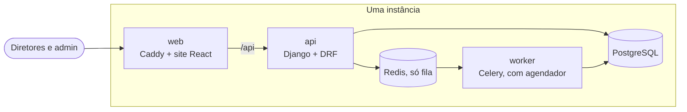
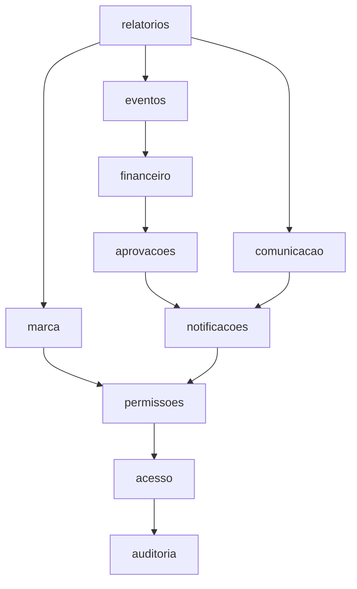
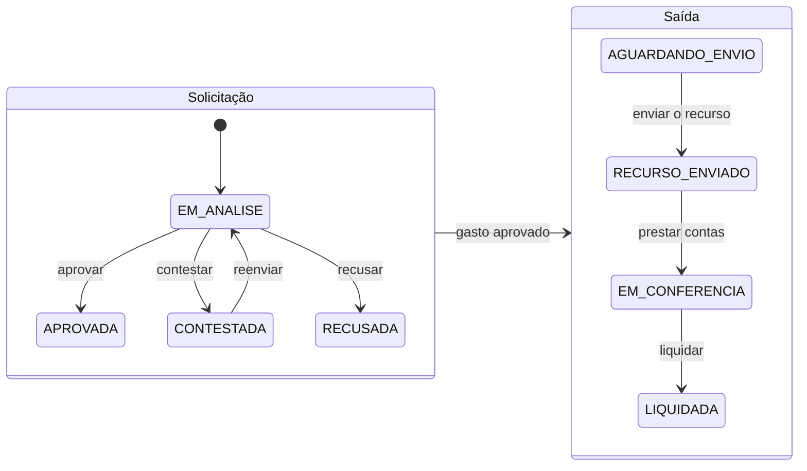

# Club Manager

Sistema de governança financeira e institucional de um time de futebol, usado pelos diretores: controle de entradas e
saídas, aprovação formal de gastos e eventos, e rastreabilidade de quem fez o quê e quando.

Os valores são escriturais: o sistema registra, e o dinheiro se move por fora, na conta do clube.

## Estado

A etapa 1 (diretores, no site) tem 13 marcos. O estado de cada um está em [docs/method.md](docs/method.md).

| Marco | Situação |
| --- | --- |
| M0 Arquitetura | Concluído: domínio, requisitos e decisões registrados |
| M1 Fundação | Concluído (`v0.1.0`): API, worker, banco, fila e site sobem com um comando |
| M2 Identidade e acesso | Concluído (`v0.2.0`): convite, cadastro, login por senha e Google, administração de usuários |
| M3 Permissões e auditoria | Concluído (na `dev`): cargos, setores, classificação, concessão de permissões e histórico |
| M4 Notificações | Concluído (na `dev`): caixa de entrada, sino, e-mail e preferências de alerta |
| M5 a M12 | Não iniciados |

Hoje o sistema cuida só do acesso: um admin criado por comando convida diretores, que se cadastram e entram. As
funções financeiras e de eventos ainda não existem.

## Subir localmente

Precisa de Docker Desktop, uv e Node 22. Passo a passo, com o resultado esperado de cada comando, em
[docs/setup/local.md](docs/setup/local.md). Em resumo:

```text
cd backend
uv sync
uv run python scripts/make_env.py
cd ..
docker compose up --build
```

O site abre em <http://localhost:8080>, na tela de entrar. O primeiro admin é criado com
`docker compose exec api python manage.py criar_admin`.

## Verificar

```text
cd backend
uv run poe verify

cd ../frontend
npm install
npm run verify
```

O CI roda os mesmos dois comandos.

## Como o sistema roda



Toda regra de negócio, permissão e auditoria fica na API. O site só chama e mostra.

## Como o código é dividido

Um módulo por área de negócio. Um módulo só importa os que estão abaixo dele, e só pela API pública; isso é
verificado em toda execução dos testes.



Os três módulos centrais são `aprovacoes`, `financeiro` e `eventos`. O ciclo que eles implementam:



Os diagramas completos (contexto, containers, estados de cada aggregate e modelo de domínio) estão em
[docs/architecture/overview.md](docs/architecture/overview.md) e em [docs/domain/](docs/domain/).

## Documentação

| Para | Leia |
| --- | --- |
| Entender o que foi pedido | [docs/challenge/phase-1.md](docs/challenge/phase-1.md) |
| Ver os requisitos | [docs/requirements/requirements.md](docs/requirements/requirements.md) |
| Entender o domínio e os termos | [docs/domain/ubiquitous-language.md](docs/domain/ubiquitous-language.md) |
| Saber por que cada escolha foi feita | [docs/adr/](docs/adr/) |
| Contribuir | [AGENTS.md](AGENTS.md) e [CONTRIBUTING.md](CONTRIBUTING.md) |
| Tudo o mais | [docs/README.md](docs/README.md) |
