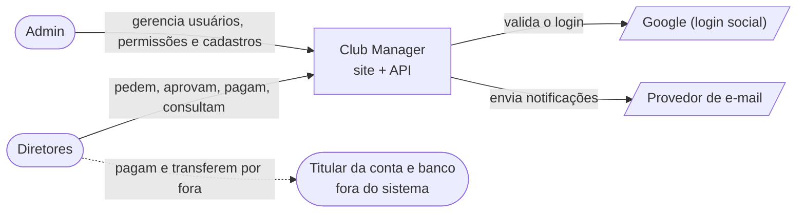
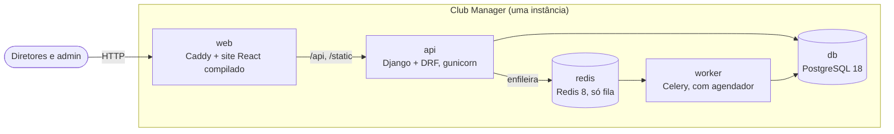
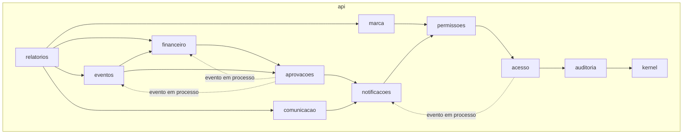
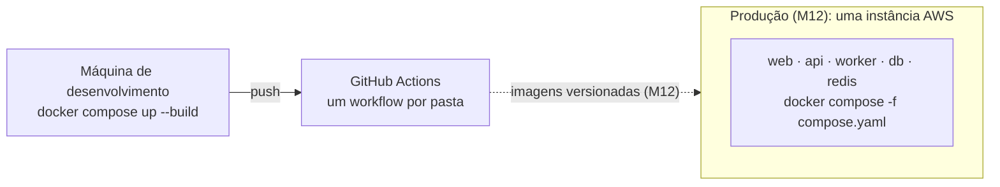

# Visão geral da arquitetura

| Campo | Valor |
| --- | --- |
| Atualizado em | 2026-11-11 |
| Decisões | ADR-001 (estilo), ADR-003 (integração), ADR-004 (backend), ADR-005 (site), ADR-006 (filas), ADR-007 (repositório e CI) |

## 1. Contexto (C4 nível 1)

O banco e o titular da conta não se integram ao sistema: os valores são escriturais (RN-023).

## 2. Containers (C4 nível 2)

| Container | Responsabilidade | Tecnologia | Decisão |
| --- | --- | --- | --- |
| `web` | Servir o site e repassar `/api` | Caddy 2; React 19, Vite 8, TypeScript 7 | ADR-005 |
| `api` | Toda a regra de negócio, permissões e auditoria | Python 3.14, Django 6.1, DRF 3.18, gunicorn | ADR-001, ADR-004 |
| `worker` | Tarefas agendadas e trabalho em segundo plano | Celery 5.7, mesma imagem da `api` | ADR-006 |
| `db` | Dados; schema só por migrações | PostgreSQL 18 | ADR-004 |
| `redis` | Fila do Celery, sem persistência | Redis 8 | ADR-006 |

## 3. Componentes / módulos (C4 nível 3)

Os módulos da `api` são os contextos do [context map](../domain/context-map.md). Um módulo só importa os que estão
abaixo dele, e só pelo `public.py`.

Setas cheias: chamada direta à API pública. Setas tracejadas: evento de integração em processo, síncrono, na mesma
transação (ADR-003). Para não poluir, o desenho omite que todo módulo usa `auditoria`, `permissoes` e `kernel`.

## 4. Implantação

| Ambiente | Para que serve | Como é criado | Guia |
| --- | --- | --- | --- |
| Local | Desenvolver e testar | `docker compose up --build` | [setup/local.md](../setup/local.md) |
| Produção | Uso real | Definido no M12 (AD-013) | `operations/` (M12) |

Não há ambiente de homologação (RNF-05).

Memória medida em repouso, com o esqueleto vazio (2026-11-11): `api` 117 MB, `worker` 144 MB, `db` 46 MB, `redis`
12 MB, `web` 12 MB; cerca de 330 MB no total.

## 5. Decisões

| ADR | Decide |
| --- | --- |
| [ADR-001](../adr/ADR-001-estilo-arquitetural.md) | Monólito modular, DDD tático no core, camadas no resto; o que não adotar |
| [ADR-002](../adr/ADR-002-repositorio-e-prototipo.md) | Reaproveitar o repositório; protótipo fora do git |
| [ADR-003](../adr/ADR-003-integracao-entre-contextos.md) | Chamada direta para cima, evento em processo para baixo |
| [ADR-004](../adr/ADR-004-backend-django-drf-postgresql.md) | Django, DRF, PostgreSQL |
| [ADR-005](../adr/ADR-005-frontend-react-vite-spa.md) | React, Vite, TypeScript, SPA |
| [ADR-006](../adr/ADR-006-filas-celery-redis.md) | Celery com Redis, um worker com agendador |
| [ADR-007](../adr/ADR-007-repositorio-ci-e-imagens.md) | Um repositório, CI por pasta, as mesmas imagens |
