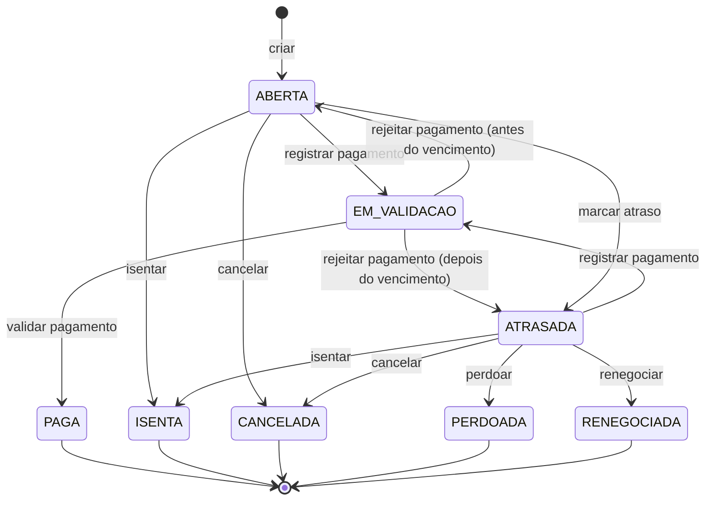

# Aggregate: Cobrança

| Campo | Valor |
| --- | --- |
| Bounded context | Financeiro |
| Status | Approved |
| Atualizado em | 2026-11-11 |
| Aprovado por / em | Leandro Nascimento / 2026-11-11 |
| Origem | Event Storming, raias A, B e C; hotspots H01 a H10, H17, H18 |

## 1. Propósito

Garantir que um valor esperado de um diretor tenha um só desfecho, e que ele só conte como recebido depois que alguém
conferiu e validou o pagamento.

## 2. Ciclo de vida

O questionamento e a convocação não são estados: são registros dentro da cobrança, que pode estar `ABERTA` ou
`ATRASADA` enquanto eles estão abertos.

## 3. Comandos aceitos

| Comando | Ator | Pré-condições | Eventos emitidos | Falhas de negócio |
| --- | --- | --- | --- | --- |
| `criar` | Quem tem a permissão, ou o agendador (por uma recorrência) | Valor maior que zero; devedor ativo; chave Pix ativa; sem suspensão vigente, se vier de recorrência | `CobrancaCriada` | `VALOR_INVALIDO`, `DEVEDOR_INATIVO`, `CHAVE_PIX_INATIVA`, `COBRANCA_SUSPENSA`, `COBRANCA_JA_GERADA` |
| `registrar_pagamento` | Devedor | `ABERTA` ou `ATRASADA`; comprovante, ou "em mão" com recebedor | `PagamentoRegistrado` | `NAO_ACEITA_PAGAMENTO`, `EVIDENCIA_OBRIGATORIA`, `RECEBEDOR_INVALIDO` |
| `validar_pagamento` | Quem tem a permissão | `EM_VALIDACAO`; motivo | `PagamentoValidado` | `NAO_ESTA_EM_VALIDACAO`, `DEVEDOR_NAO_VALIDA`, `MOTIVO_OBRIGATORIO` |
| `rejeitar_pagamento` | Quem tem a permissão | `EM_VALIDACAO`; motivo | `PagamentoRejeitado` | As de `validar_pagamento` |
| `marcar_atraso` | Agendador | `ABERTA`; vencimento passou | `CobrancaAtrasada` | Nenhuma: repetir não faz nada |
| `questionar` | Devedor | `ABERTA` ou `ATRASADA`; texto; sem questionamento aberto | `CobrancaQuestionada` | `NAO_ACEITA_QUESTIONAMENTO`, `QUESTIONAMENTO_JA_ABERTO` |
| `decidir_questionamento` | Quem tem a permissão | Questionamento aberto; motivo; decisão é isentar, cancelar ou manter | `QuestionamentoDecidido` e, conforme o caso, `CobrancaIsenta` ou `CobrancaCancelada` | `SEM_QUESTIONAMENTO_ABERTO`, `MOTIVO_OBRIGATORIO` |
| `isentar` | Quem tem a permissão de isentar | `ABERTA` ou `ATRASADA`; justificativa | `CobrancaIsenta` | `NAO_PODE_ISENTAR` |
| `cancelar` | Quem tem a permissão | `ABERTA` ou `ATRASADA`; motivo | `CobrancaCancelada` | `NAO_PODE_CANCELAR` |
| `convocar` | Agendador | `ATRASADA`; o limite de inadimplência acabou; sem convocação | `DevedorConvocado` | Nenhuma: repetir não faz nada |
| `justificar_divida` | Devedor | Convocação aberta; texto | `DividaJustificada` | `SEM_CONVOCACAO_ABERTA` |
| `perdoar` | Quem tem a permissão | `ATRASADA`; motivo | `DividaPerdoada` | `NAO_ESTA_ATRASADA` |
| `renegociar` | Quem tem a permissão | `ATRASADA`; motivo; parcelas válidas | `DividaRenegociada` | `NAO_ESTA_ATRASADA`, `PARCELAS_INVALIDAS` |
| `manter_divida` | Quem tem a permissão | Convocação aberta; motivo | `DividaMantida` | `SEM_CONVOCACAO_ABERTA` |

## 4. Invariantes

| ID | Regra | Como é garantida | Teste |
| --- | --- | --- | --- |
| INV-COB-01 | O valor é maior que zero, em reais, com duas casas decimais | Value object `Dinheiro`, na criação | Rito 8 |
| INV-COB-02 | A cobrança tem um só desfecho: `PAGA`, `ISENTA`, `CANCELADA`, `PERDOADA` e `RENEGOCIADA` não aceitam nenhum comando | Em todos os métodos | Rito 8 |
| INV-COB-03 | Só existe um pagamento em validação por vez | Em `registrar_pagamento` | Rito 8 |
| INV-COB-04 | Todo pagamento tem evidência: comprovante anexado, ou a marca "em mão" com um recebedor que é usuário ativo e não é o devedor | Na criação do `Pagamento` | Rito 8 |
| INV-COB-05 | Quem valida ou rejeita um pagamento não é o devedor da cobrança | Em `validar_pagamento` e `rejeitar_pagamento` | Rito 8 |
| INV-COB-06 | Validar e rejeitar exigem motivo de decisão | Na criação da decisão do pagamento | Rito 8 |
| INV-COB-07 | Pagamento rejeitado devolve a cobrança a `ATRASADA` se o vencimento passou, e a `ABERTA` se não passou | Uma função só, `estado_sem_pagamento`, usada em todo retorno | Rito 8 |
| INV-COB-08 | Só existe um questionamento aberto por vez, e só o devedor questiona | Em `questionar` | Rito 8 |
| INV-COB-09 | A convocação é aberta uma vez só, quando a cobrança está `ATRASADA` e o vencimento mais o limite de inadimplência já passou | Em `convocar`; o comando é idempotente | Rito 8 |
| INV-COB-10 | Perdão e renegociação só acontecem em cobrança `ATRASADA`, com motivo | Em `perdoar` e `renegociar` | Rito 8 |
| INV-COB-11 | Uma recorrência gera no máximo uma cobrança por devedor e por competência | Restrição de unicidade no banco; `criar` falha com `COBRANCA_JA_GERADA` | Rito 8 |
| INV-COB-12 | A cobrança guarda a chave Pix e o Pix copia e cola gerados na criação; mudar a chave depois não altera cobranças existentes | Snapshot na criação | Rito 8 |
| INV-COB-13 | Uma cobrança que é parcela guarda a cobrança de origem, e a origem está `RENEGOCIADA` | Na criação das parcelas, pelo serviço de renegociação | Rito 8 |

## 5. Policies corretivas

| Situação | Policy | Responsável |
| --- | --- | --- |
| O devedor é desativado com cobranças abertas | Regra a definir no refinamento do M6 (FIN-12) | Leandro |
| A chave Pix da cobrança é desativada depois da criação | A cobrança continua com a chave antiga; quem tem a permissão pode cancelar e recriar | Serviço financeiro |
| Uma cobrança `PAGA` precisa ser desfeita | Estorno: novo lançamento ligado à cobrança (AD-010) | Serviço financeiro |

## 6. Composição

| Elemento | Tipo | Observação |
| --- | --- | --- |
| `Cobranca` | Aggregate Root | Devedor, categoria, valor, vencimento, limite de inadimplência, estado, origem (recorrência e competência, ou cobrança renegociada) |
| `Pagamento` | Entity | Uma tentativa de pagamento: forma (comprovante ou em mão), anexo, recebedor, momento, decisão (validado ou rejeitado, com motivo aplicado) |
| `Questionamento` | Entity | Texto do devedor, momento, decisão (isentar, cancelar ou manter) com motivo aplicado |
| `Convocacao` | Entity | Momento da abertura, justificativa do devedor, decisão (perdoar, renegociar ou manter) com motivo aplicado |
| `Dinheiro` | Value Object | Decimal com duas casas, em reais |
| `PixCopiaECola` | Value Object | Código gerado a partir da chave, do valor e do identificador da cobrança; o QR Code é a imagem dele |
| `MotivoAplicado` | Value Object | ID e texto do motivo no momento, mais texto livre opcional |

## 7. Referências e snapshots

| Referência | Contexto de origem | Por ID? | Snapshot (campos e quando congela) |
| --- | --- | --- | --- |
| `devedor_id`, `recebedor_id`, quem decidiu | Identidade e Permissões | Sim | Nenhum |
| `categoria_id` | Financeiro (cadastro) | Sim | Nome da categoria, na criação |
| `chave_pix_id` | Financeiro (cadastro) | Sim | Chave e código copia e cola, na criação |
| `recorrencia_id` | Financeiro | Sim | Competência, na criação |
| `cobranca_origem_id` | Financeiro | Sim | Nenhum |
| Motivo de decisão | Aprovações (cadastro) | Sim | Texto, na decisão |
| Comprovante | Anexos | Sim | Nenhum |

## 8. Volume e concorrência

- Vazão esperada: uma cobrança por diretor por mês, mais as avulsas; dezenas por mês.
- Conflitos prováveis: o agendador marcando atraso enquanto o devedor registra o pagamento; duas pessoas validando o
  mesmo pagamento; a tarefa de geração rodando duas vezes.
- Estratégia: bloqueio da linha da cobrança durante o comando; comandos do agendador idempotentes; unicidade por
  recorrência, devedor e competência.

## 9. Casos de borda fechados

| Pergunta | Decisão | Data | Quem decidiu |
| --- | --- | --- | --- |
| O pagamento rejeitado termina a cobrança? | Não. Fica registrado e o devedor refaz o processo | 2026-11-11 | Leandro Nascimento |
| Perdão é isenção ou cancelamento? | Nenhum dos dois: é um desfecho próprio | 2026-11-11 | Leandro Nascimento |
| O que a renegociação produz? | Encerra a original e gera parcelas ligadas a ela | 2026-11-11 | Leandro Nascimento |
| Onde acontece a convocação? | Dentro do sistema: o devedor justifica na cobrança e os responsáveis decidem | 2026-11-11 | Leandro Nascimento |
| Quem decide um questionamento? | Um usuário com a permissão; não há votação | 2026-11-11 | Leandro Nascimento |
| Quem pode ser o recebedor do dinheiro em mão? | Um usuário do sistema; o validador o consulta por fora | 2026-11-11 | Leandro Nascimento |
| O devedor pode validar o próprio pagamento, se tiver a permissão? | Não (INV-COB-05) | 2026-11-11 | Leandro Nascimento |
| "Questionada" é um estado da cobrança? | Não. Questionamento e convocação são registros dentro da cobrança | 2026-11-11 | Leandro Nascimento |

## 10. Perguntas em aberto

- Perdoar ou renegociar exige que o devedor tenha justificado antes, ou os responsáveis podem decidir sem esperar?
  Proposta: podem decidir sem esperar → refinamento do M6
- Questionamento aberto pausa os avisos de atraso e a convocação? (hipótese do enunciado, FIN-10) → refinamento do M6
- Pagamento parcial de uma cobrança existe? O canvas supõe que não → refinamento do M6
- Estorno de cobrança paga → AD-010
