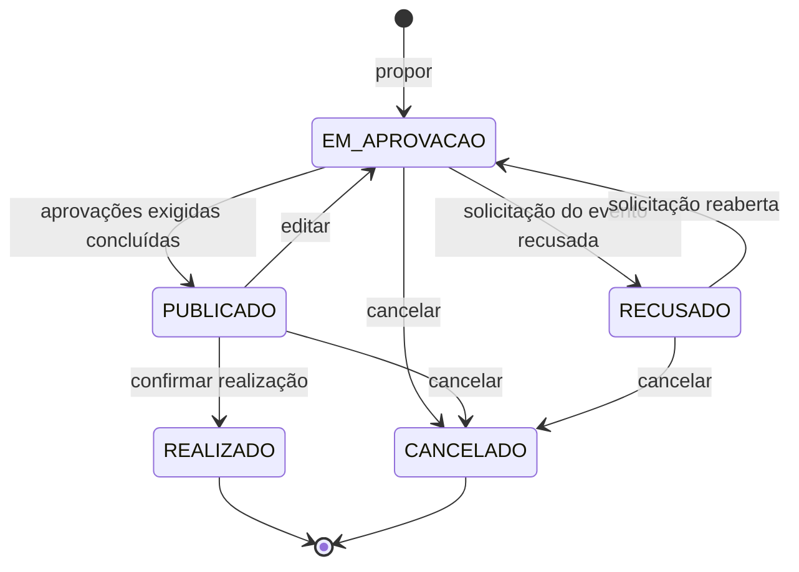

# Aggregate: Evento

| Campo | Valor |
| --- | --- |
| Bounded context | Eventos |
| Status | Approved |
| Atualizado em | 2026-11-11 |
| Aprovado por / em | Leandro Nascimento / 2026-11-11 |
| Origem | Event Storming, raia F; hotspots H20, H22, H24, H27, H28 |

## 1. Propósito

Garantir que só apareça no calendário o evento que teve todas as aprovações exigidas, e que um evento encerrado não
mude mais.

## 2. Ciclo de vida

`EM_APROVACAO`, `PUBLICADO` e `RECUSADO` são derivados da situação das solicitações do evento (ver "Status derivado"
em `domain-events.md`). `REALIZADO` e `CANCELADO` são gravados por comando.

## 3. Comandos aceitos

| Comando | Ator | Pré-condições | Eventos emitidos | Falhas de negócio |
| --- | --- | --- | --- | --- |
| `propor` | Diretor com a permissão | Título, data e categoria de evento; marca "envolve custo" | `EventoProposto` | `DADOS_INCOMPLETOS` |
| `vincular_orcamento` | Quem tem a permissão (responsável por eventos) | Evento com custo; sem orçamento vinculado; não encerrado | `OrcamentoVinculado` | `EVENTO_SEM_CUSTO`, `ORCAMENTO_JA_VINCULADO` |
| `editar` | Proponente ou quem tem a permissão | Não está `REALIZADO` nem `CANCELADO` | `EventoEditado` e, se estava publicado, `EventoDespublicado` | `EVENTO_ENCERRADO` |
| `atualizar_situacao` | Sistema, ao reagir às decisões das solicitações | Não encerrado | `EventoPublicado`, `EventoDespublicado` ou `EventoRecusado`, quando a situação muda | Nenhuma: repetir não faz nada |
| `confirmar_realizacao` | Proponente, quem tem a permissão ou admin | `PUBLICADO`; a data de realização não é futura | `EventoRealizado` | `NAO_ESTA_PUBLICADO`, `DATA_FUTURA` |
| `cancelar` | Proponente, admin ou quem tem a permissão | Não está `REALIZADO` nem `CANCELADO`; motivo | `EventoCancelado` | `EVENTO_ENCERRADO`, `MOTIVO_OBRIGATORIO` |

## 4. Invariantes

| ID | Regra | Como é garantida | Teste |
| --- | --- | --- | --- |
| INV-EVT-01 | O evento só está `PUBLICADO` se a solicitação do evento está aprovada e, quando envolve custo, a solicitação orçamentária também | Uma função pura só, `situacao_do_evento`, chamada por `atualizar_situacao` | Rito 8 |
| INV-EVT-02 | O evento que envolve custo não guarda valor: o custo existe só na solicitação orçamentária vinculada | Não há campo de valor no aggregate | Rito 8 |
| INV-EVT-03 | Editar um evento publicado o tira do calendário até nova aprovação | `editar` cria nova versão da solicitação do evento, e a situação é recalculada | Rito 8 |
| INV-EVT-04 | `REALIZADO` e `CANCELADO` não aceitam nenhum comando | Em todos os métodos | Rito 8 |
| INV-EVT-05 | Só se confirma a realização de um evento `PUBLICADO`, e com data que não é futura | Em `confirmar_realizacao` | Rito 8 |
| INV-EVT-06 | Cancelar exige motivo | Em `cancelar` | Rito 8 |
| INV-EVT-07 | Um evento tem no máximo uma solicitação orçamentária vinculada | Em `vincular_orcamento` | Rito 8 |

## 5. Policies corretivas

| Situação | Policy | Responsável |
| --- | --- | --- |
| A data do evento chegou e ninguém confirmou | O agendador notifica o proponente, quem tem a permissão e o admin; o reenvio é pendência do M4 | Agendador |
| O evento é cancelado com a solicitação orçamentária ainda sem envio de recurso | A solicitação orçamentária é cancelada | Serviço de eventos chama Aprovações |
| O evento é cancelado com o recurso já enviado | A saída segue o ciclo dela: prestação de contas e devolução. Detalhe a definir no refinamento do M8 | Leandro |
| O orçamento é recusado em definitivo | O evento fica `EM_APROVACAO`, fora do calendário, até ser cancelado (H28) | Leandro |

## 6. Composição

| Elemento | Tipo | Observação |
| --- | --- | --- |
| `Evento` | Aggregate Root | Título, descrição, data, categoria de evento, proponente, envolve custo, estado, solicitação do evento, solicitação orçamentária |
| `Realizacao` | Value Object | Data em que aconteceu, quem confirmou, momento e, se a data difere da planejada, o motivo |
| `Cancelamento` | Value Object | Motivo, quem cancelou, momento |

## 7. Referências e snapshots

| Referência | Contexto de origem | Por ID? | Snapshot (campos e quando congela) |
| --- | --- | --- | --- |
| `solicitacao_do_evento_id` | Aprovações | Sim | Estado da solicitação, a cada decisão |
| `solicitacao_orcamentaria_id` | Aprovações (aberta pelo Financeiro) | Sim | Estado da solicitação, a cada decisão |
| `proponente_id`, quem confirmou, quem cancelou | Identidade e Permissões | Sim | Nenhum |
| `categoria_de_evento_id` | Eventos (cadastro) | Sim | Nome, na proposta |

## 8. Volume e concorrência

- Vazão esperada: poucos por mês.
- Conflitos prováveis: cancelar enquanto uma aprovação chega.
- Estratégia: bloqueio da linha do evento durante o comando; `atualizar_situacao` é idempotente.

## 9. Casos de borda fechados

| Pergunta | Decisão | Data | Quem decidiu |
| --- | --- | --- | --- |
| Evento com custo é uma solicitação com dois aprovadores? | Não: são duas solicitações distintas, a do evento e a orçamentária | 2026-11-11 | Leandro Nascimento |
| Quando o evento com custo entra no calendário? | Só com as duas solicitações aprovadas | 2026-11-11 | Leandro Nascimento |
| Quem confirma a realização? | O proponente, um responsável por eventos ou o admin; o primeiro que fizer encerra | 2026-11-11 | Leandro Nascimento |
| Mudar a data de um evento publicado? | É editar: sai do calendário e volta à aprovação | 2026-11-11 | Leandro Nascimento |
| O evento só é realizado depois de a saída do orçamento ser liquidada? | Não. Evento e orçamento encerram separadamente | 2026-11-11 | Leandro Nascimento |

## 10. Perguntas em aberto

- Evento sem custo precisa sempre de aprovação? → H27, refinamento do M8
- Orçamento recusado em definitivo: quem cancela o evento, e há prazo? → H28, refinamento do M8
- Evento que aconteceu antes da data: o enunciado prevê atualizar a data com motivo, sem reabrir a aprovação
  (EVT-07, hipótese); o canvas segue isso em `Realizacao` → confirmar no refinamento do M8
- Participação em eventos → pendência do M8
