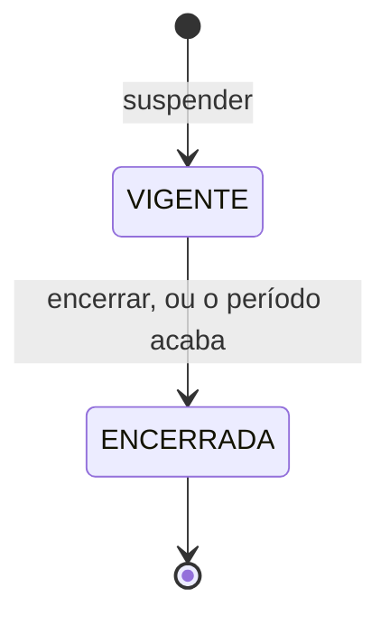
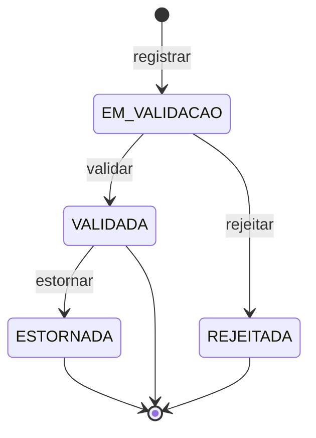

# Aggregates menores do Financeiro

| Campo | Valor |
| --- | --- |
| Bounded context | Financeiro |
| Status | Approved |
| Atualizado em | 2026-11-11 |
| Aprovado por / em | Leandro Nascimento / 2026-11-11 |
| Origem | Event Storming, raias A, B, C e E; hotspots H09, H13, H17 |

Quatro aggregates pequenos, cada um com uma regra a proteger. Ficam num arquivo só porque nenhum tem ciclo de vida
longo.

## Recorrência

**Propósito:** descrever a cobrança que se repete para um diretor, para o agendador gerar cada uma sem duplicar.

| Comando | Ator | Pré-condições | Eventos emitidos |
| --- | --- | --- | --- |
| `criar` | Quem tem a permissão | Devedor ativo; valor maior que zero; periodicidade; dia de vencimento; chave Pix ativa; limite de inadimplência | `RecorrenciaCriada` |
| `alterar` | Quem tem a permissão | Ativa | `RecorrenciaAlterada` |
| `desativar` | Quem tem a permissão | Ativa | `RecorrenciaDesativada` |

| ID | Regra | Como é garantida |
| --- | --- | --- |
| INV-REC-01 | Alterar valor ou vencimento vale só para as próximas competências; cobranças já geradas não mudam | A cobrança copia os dados na criação |
| INV-REC-02 | Uma recorrência desativada não gera cobrança | Na geração |
| INV-REC-03 | Recorrência de devedor desativado não gera cobrança (FIN-12) | Na geração |
| INV-REC-04 | A competência a gerar é calculada só pela periodicidade e pela data, por uma função pura | Value object `Competencia` |

A mensalidade de cada diretor (FIN-03) é uma recorrência mensal com o valor dele.

## Suspensão de cobranças

**Propósito:** impedir que cobranças recorrentes de um diretor sejam geradas durante um período, com justificativa.

| Comando | Ator | Pré-condições | Eventos emitidos |
| --- | --- | --- | --- |
| `suspender` | Quem tem a permissão | Diretor; início; fim opcional; justificativa; alcance (uma recorrência ou todas) | `CobrancasSuspensas` |
| `encerrar` | Quem tem a permissão, ou o agendador no fim do período | Vigente | `SuspensaoEncerrada` |

| ID | Regra | Como é garantida |
| --- | --- | --- |
| INV-SUS-01 | O fim, quando informado, não é anterior ao início | Value object `Periodo` |
| INV-SUS-02 | Toda suspensão tem justificativa | Em `suspender` |
| INV-SUS-03 | Enquanto vigente, nenhuma cobrança do alcance é gerada para o diretor; a competência pulada não é gerada depois | Na geração, consultando as suspensões vigentes na data da competência |
| INV-SUS-04 | A suspensão não afeta cobranças já geradas | Só a geração a consulta |

## Entrada

**Propósito:** registrar dinheiro que entrou sem cobrança (patrocínio, rifa, ajuda) ou como devolução de um gasto,
sempre validado.

| Comando | Ator | Pré-condições | Eventos emitidos |
| --- | --- | --- | --- |
| `registrar` | Quem tem a permissão; ou o solicitante de uma saída, para uma devolução | Valor maior que zero; categoria; evidência (comprovante ou texto) | `EntradaRegistrada` |
| `validar` | Quem tem a permissão | `EM_VALIDACAO`; motivo | `EntradaValidada` |
| `rejeitar` | Quem tem a permissão | `EM_VALIDACAO`; motivo | `EntradaRejeitada` |
| `estornar` | Quem tem a permissão | `VALIDADA`; justificativa | `EntradaEstornada` |

| ID | Regra | Como é garantida |
| --- | --- | --- |
| INV-ENT-01 | Toda entrada tem evidência: comprovante ou texto | Na criação |
| INV-ENT-02 | Só entrada `VALIDADA` conta como realizada | Estado; os relatórios leem só as validadas |
| INV-ENT-03 | Uma devolução está ligada a uma saída em `RECURSO_ENVIADO` ou `EM_CONFERENCIA`, e a soma das devoluções não passa do valor enviado | Em `registrar`, com os totais passados pelo serviço |
| INV-ENT-04 | Quem valida uma devolução não é quem a registrou | Em `validar` |

Pergunta em aberto: quem valida uma entrada sem devedor, e se pode ser quem a registrou → pendência do M6.

## Renegociação

**Propósito:** registrar o acordo que encerrou uma cobrança atrasada e gerou as parcelas.

| Comando | Ator | Pré-condições | Eventos emitidos |
| --- | --- | --- | --- |
| `registrar` | Quem tem a permissão, pelo comando `renegociar` da cobrança | Cobrança `ATRASADA`; ao menos uma parcela; motivo | `DividaRenegociada`, `ParcelasGeradas` |

| ID | Regra | Como é garantida |
| --- | --- | --- |
| INV-REN-01 | A renegociação é imutável depois de registrada | Sem comandos de alteração |
| INV-REN-02 | Cada parcela tem valor maior que zero e vencimento não anterior à data do acordo | Na criação |
| INV-REN-03 | A cobrança original passa a `RENEGOCIADA` e as parcelas nascem na mesma transação | Serviço de renegociação: exceção registrada ao princípio "uma transação, um aggregate" |
| INV-REN-04 | Uma cobrança é renegociada no máximo uma vez; uma parcela atrasada pode ser renegociada de novo, como cobrança que é | INV-COB-02 |

Caso de borda fechado (Leandro Nascimento, 2026-11-11): as parcelas não precisam somar o valor original; o acordo
pode dar desconto ou acréscimo, e o valor acordado fica registrado.
