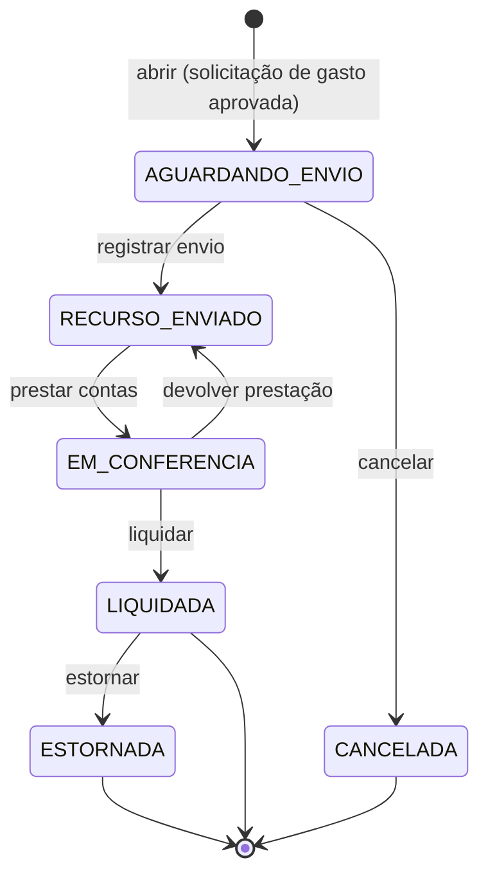

# Aggregate: Saída

| Campo | Valor |
| --- | --- |
| Bounded context | Financeiro |
| Status | Approved |
| Atualizado em | 2026-11-11 |
| Aprovado por / em | Leandro Nascimento / 2026-11-11 |
| Origem | Event Storming, raia E; hotspots H13, H14, H15 |

## 1. Propósito

Garantir que o dinheiro só saia com solicitação aprovada, que o valor enviado nunca passe do aprovado, e que a saída
só seja encerrada depois de comprovado o gasto e acertada a diferença.

## 2. Ciclo de vida

`RECURSO_ENVIADO` é o que o enunciado chama de "prestação de contas pendente". Os estados "pendente de aprovação",
"recusada" e "aprovada" do enunciado pertencem à solicitação, não à saída.

## 3. Comandos aceitos

| Comando | Ator | Pré-condições | Eventos emitidos | Falhas de negócio |
| --- | --- | --- | --- | --- |
| `abrir` | Sistema, ao reagir a `SolicitacaoAprovada` de uma solicitação de gasto | Não existe saída para a solicitação | `SaidaAberta` | `SAIDA_JA_EXISTE` |
| `registrar_envio` | Quem tem a permissão (financeiro) | `AGUARDANDO_ENVIO`; comprovante de envio; valor enviado até o aprovado | `RecursoEnviado` | `NAO_AGUARDA_ENVIO`, `COMPROVANTE_OBRIGATORIO`, `VALOR_ACIMA_DO_APROVADO` |
| `prestar_contas` | Solicitante | `RECURSO_ENVIADO`; valor gasto; comprovante de gasto ou justificativa em texto | `PrestacaoDeContasRegistrada` | `NAO_AGUARDA_PRESTACAO`, `EVIDENCIA_OBRIGATORIA`, `SO_O_SOLICITANTE` |
| `devolver_prestacao` | Quem tem a permissão (financeiro) | `EM_CONFERENCIA`; motivo | `PrestacaoDevolvida` | `NAO_ESTA_EM_CONFERENCIA` |
| `liquidar` | Quem tem a permissão (financeiro) | `EM_CONFERENCIA`; diferença acertada (INV-SAI-05) | `SaidaLiquidada` | `NAO_ESTA_EM_CONFERENCIA`, `DIFERENCA_NAO_ACERTADA`, `SOLICITANTE_NAO_LIQUIDA` |
| `cancelar` | Quem tem a permissão | `AGUARDANDO_ENVIO`; motivo | `SaidaCancelada` | `RECURSO_JA_ENVIADO` |
| `estornar` | Quem tem a permissão | `LIQUIDADA`; justificativa | `SaidaEstornada` | `NAO_ESTA_LIQUIDADA` |

A devolução não é um comando da saída: é uma `Entrada` do tipo devolução, ligada à saída, registrada pelo solicitante
e validada como qualquer entrada. O complemento é uma nova solicitação de gasto, ligada à saída.

## 4. Invariantes

| ID | Regra | Como é garantida | Teste |
| --- | --- | --- | --- |
| INV-SAI-01 | Uma saída só nasce de uma solicitação de gasto aprovada, e cada solicitação tem no máximo uma saída | Em `abrir`; unicidade pelo ID da solicitação | Rito 8 |
| INV-SAI-02 | O valor enviado é maior que zero e não passa do valor aprovado | Em `registrar_envio` | Rito 8 |
| INV-SAI-03 | Registrar o envio exige o comprovante de envio | Em `registrar_envio` | Rito 8 |
| INV-SAI-04 | A prestação de contas tem o valor gasto e uma evidência: comprovante de gasto ou justificativa em texto | Na criação da `PrestacaoDeContas` | Rito 8 |
| INV-SAI-05 | A saída só é liquidada com a diferença acertada: se gastou menos, as devoluções validadas somam a diferença; se gastou mais, há um complemento aprovado que cobre a diferença | Em `liquidar`; os totais de devolução e de complemento são passados pelo serviço | Rito 8 |
| INV-SAI-06 | Quem liquida não é o solicitante da saída | Em `liquidar` | Rito 8 |
| INV-SAI-07 | `LIQUIDADA`, `CANCELADA` e `ESTORNADA` não aceitam edição; de `LIQUIDADA` só se sai por `estornar` | Em todos os métodos | Rito 8 |
| INV-SAI-08 | Só se cancela antes do envio do recurso | Em `cancelar` | Rito 8 |
| INV-SAI-09 | O estorno não altera a saída original: cria um lançamento novo, ligado a ela, com justificativa | Em `estornar` | Rito 8 |

## 5. Policies corretivas

| Situação | Policy | Responsável |
| --- | --- | --- |
| A solicitação aprovada é editada antes do envio | A solicitação volta a `EM_ANALISE` e a saída em `AGUARDANDO_ENVIO` é cancelada; uma nova saída nasce na nova aprovação | Serviço financeiro, ao reagir a `SolicitacaoEditada` |
| A solicitação é cancelada antes do envio | A saída é cancelada | Serviço financeiro, ao reagir a `SolicitacaoCancelada` |
| O recurso foi enviado | A solicitação passa a `EM_EXECUCAO` e não pode mais ser editada nem cancelada | Serviço financeiro chama Aprovações |
| A saída é liquidada | A solicitação é encerrada | Serviço financeiro chama Aprovações |
| A prestação de contas não chega | Prazo e cobrança automática a definir (pendência do M7) | Leandro |

## 6. Composição

| Elemento | Tipo | Observação |
| --- | --- | --- |
| `Saida` | Aggregate Root | Solicitação de origem, solicitante, categoria, setor, valor aprovado, estado |
| `Envio` | Entity | Valor enviado, comprovante de envio, quem registrou, momento |
| `PrestacaoDeContas` | Entity | Valor gasto, comprovante de gasto ou justificativa, momento; uma devolvida fica no histórico e a seguinte a substitui |
| `Dinheiro` | Value Object | Decimal com duas casas, em reais |

Os itens (descrição e valor) vivem no conteúdo da versão da solicitação de gasto; a saída guarda o total aprovado.

## 7. Referências e snapshots

| Referência | Contexto de origem | Por ID? | Snapshot (campos e quando congela) |
| --- | --- | --- | --- |
| `solicitacao_id` | Aprovações | Sim | Valor aprovado, categoria, setor e número da versão aprovada, na abertura |
| `solicitante_id`, quem enviou, quem liquidou | Identidade e Permissões | Sim | Nenhum |
| `evento_id` (se for orçamento de evento) | Eventos | Sim | Nenhum |
| Comprovantes | Anexos | Sim | Nenhum |

## 8. Volume e concorrência

- Vazão esperada: algumas por semana.
- Conflitos prováveis: liquidar enquanto uma devolução está sendo validada.
- Estratégia: bloqueio da linha da saída durante o comando; `liquidar` relê os totais dentro da transação.

## 9. Casos de borda fechados

| Pergunta | Decisão | Data | Quem decidiu |
| --- | --- | --- | --- |
| Gasto maior que o enviado? | Precisa de nova aprovação (complemento) | 2026-11-11 | Leandro Nascimento |
| Gasto menor que o enviado? | Devolução registrada como entrada ligada à saída, validada pelo financeiro | 2026-11-11 | Leandro Nascimento |
| Quando a saída é liquidada? | Quando o financeiro confere a prestação de contas e encerra | 2026-11-11 | Leandro Nascimento |
| Itens em texto ou estruturados? | Lista de itens com descrição e valor | 2026-11-11 | Leandro Nascimento |
| O solicitante pode liquidar a própria saída, se tiver a permissão? | Não (INV-SAI-06) | 2026-11-11 | Leandro Nascimento |

## 10. Perguntas em aberto

- Se o complemento for recusado, como a saída é liquidada? → refinamento do M7
- Prazo da prestação de contas e cobrança automática → pendência do M7
- O envio pode ser parcial, em mais de uma transferência? O canvas supõe um envio só → refinamento do M7
- Modelo do estorno → AD-010
