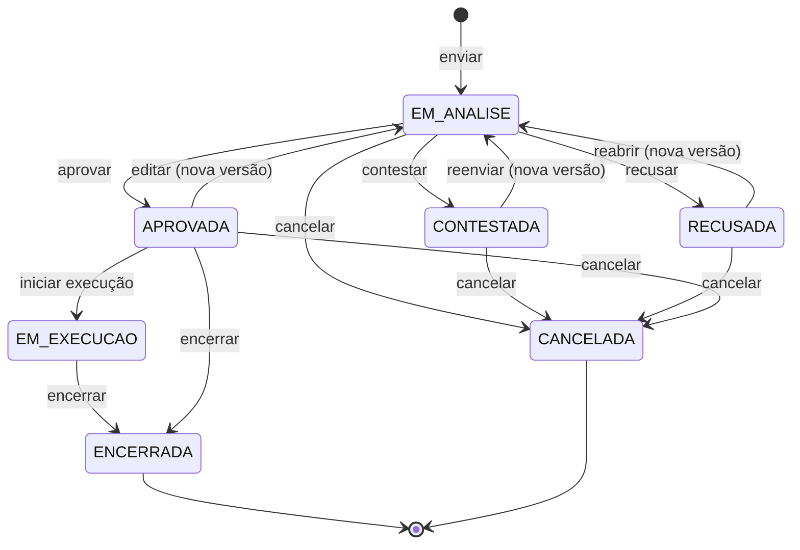
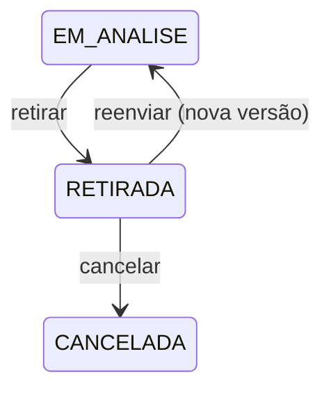

# Aggregate: Solicitação

| Campo | Valor |
| --- | --- |
| Bounded context | Aprovações |
| Status | Approved |
| Atualizado em | 2026-11-14 |
| Aprovado por / em | Leandro Nascimento / 2026-11-11 |
| Origem | Event Storming, raia D; hotspots H12, H16, H19, H21, H26 |

## 1. Propósito

Garantir que um pedido só produza efeito depois de uma decisão formal, tomada por alguém que não é o solicitante,
justificada e presa à versão exata do que foi pedido.

O aggregate não sabe do que o pedido trata. O conteúdo de cada versão pertence ao contexto que registrou o tipo de
solicitação (Financeiro ou Eventos).

## 2. Ciclo de vida

`EM_EXECUCAO` e `ENCERRADA` são comandados pelo contexto dono do tipo: o Financeiro inicia a execução quando envia o
recurso e encerra quando liquida a saída; Eventos encerra quando o evento é realizado.

## 3. Comandos aceitos

| Comando | Ator | Pré-condições | Eventos emitidos | Falhas de negócio |
| --- | --- | --- | --- | --- |
| `enviar` | Solicitante (pelo contexto dono) | Tipo registrado; se o solicitante pode decidir esse tipo, um aprovador indicado | `SolicitacaoEnviada` | `VALIDATION_ERROR` (tipo desconhecido ou conteúdo recusado), `PERMISSION_DENIED`, `APROVADOR_NAO_INDICADO`, `APROVADOR_INVALIDO` |
| `aprovar` | Aprovador | `EM_ANALISE`; motivo | `SolicitacaoAprovada` | `NAO_ESTA_EM_ANALISE`, `SOLICITANTE_NAO_DECIDE`, `PERMISSION_DENIED`, `VALIDATION_ERROR` (motivo ausente, inativo ou de outro tipo de decisão) |
| `contestar` | Aprovador | `EM_ANALISE`; motivo e mensagem; teto sugerido só se a versão tem valor | `SolicitacaoContestada` | As de `aprovar`, mais `VALIDATION_ERROR` (sem mensagem; teto que não é maior que zero) e `TETO_SEM_VALOR` |
| `recusar` | Aprovador | `EM_ANALISE`; motivo | `SolicitacaoRecusada` | As de `aprovar` |
| `reenviar` | Solicitante | `CONTESTADA`; conteúdo novo | `SolicitacaoReenviada` | `NAO_ESTA_CONTESTADA_NEM_RETIRADA`, `SO_O_SOLICITANTE` |
| `reabrir` | Solicitante, admin ou quem tem a permissão | `RECUSADA`; justificativa; conteúdo novo opcional | `SolicitacaoReaberta` | `NAO_ESTA_RECUSADA`, `PERMISSION_DENIED`, `VALIDATION_ERROR` (sem justificativa) |
| `editar` | Solicitante | `APROVADA`; conteúdo novo | `SolicitacaoEditada` | `NAO_PODE_EDITAR`, `SO_O_SOLICITANTE` |
| `iniciar_execucao` | Contexto dono | `APROVADA` | `SolicitacaoEmExecucao` | `NAO_ESTA_APROVADA` |
| `encerrar` | Contexto dono | `APROVADA` ou `EM_EXECUCAO` | `SolicitacaoEncerrada` | `NAO_PODE_ENCERRAR` |
| `cancelar` | Solicitante, admin ou quem tem a permissão | Não está em `EM_EXECUCAO`, `ENCERRADA` nem `CANCELADA`; motivo | `SolicitacaoCancelada` | `NAO_PODE_CANCELAR`, `PERMISSION_DENIED`, `VALIDATION_ERROR` (sem motivo) |

Códigos alinhados à tabela de erros da technical-spec `aprovacoes/motor-de-solicitacoes` e ao adendo 1 dela,
como estão no código (`backend/aprovacoes/erros.py`), em 2026-11-14. A verificação de quem pode vem antes da
de situação.

## 4. Invariantes

| ID | Regra | Como é garantida | Teste |
| --- | --- | --- | --- |
| INV-SOL-01 | Só se decide uma solicitação `EM_ANALISE`, e a decisão vale para a versão vigente | Em `aprovar`, `contestar` e `recusar`, antes de mudar o estado | Em `backend/aprovacoes/tests/`: `test_decisoes.py::test_ca05_inv_sol_01_fora_de_analise_nao_se_decide`, `::test_inv_sol_01_a_decisao_vale_para_a_versao_vigente` |
| INV-SOL-02 | O solicitante nunca decide o próprio pedido, salvo com a permissão de auto-aprovação; nesse caso a decisão fica marcada como aprovação própria | No método de decisão; a permissão é verificada pelo serviço e passada como fato | Em `backend/aprovacoes/tests/`: `test_decisores.py::test_inv_sol_02_*`; `test_decisoes.py::test_ca19_*`, `::test_ca22_*`, `::test_ca23_*`, `::test_ca24_*`, `::test_ca25_*` |
| INV-SOL-03 | Cada versão tem no máximo uma decisão | No método de decisão | Em `backend/aprovacoes/tests/`: `test_decisoes.py::test_inv_sol_03_a_versao_decidida_nao_recebe_outra_decisao` |
| INV-SOL-04 | Toda decisão tem aprovador, motivo de decisão e momento; contestar tem também mensagem | Na criação da `Decisao` | Em `backend/aprovacoes/tests/`: `test_decisoes.py::test_ca08_inv_sol_04_contestar_sem_mensagem_e_recusado`, `::test_ca04_*` |
| INV-SOL-05 | Uma versão nunca é alterada; reenviar, reabrir e editar criam a versão seguinte | Versões só são acrescentadas | Em `backend/aprovacoes/tests/`: `test_modelos.py::test_inv_sol_05_versao_nao_muda`, `::test_banco_recusa_alterar_e_apagar_versao`; `test_ciclo_do_solicitante.py::test_ca09_*` |
| INV-SOL-06 | Decisões de versões anteriores não valem para a versão vigente | O estado volta a `EM_ANALISE` a cada versão nova | Em `backend/aprovacoes/tests/`: `test_ciclo_do_solicitante.py::test_inv_sol_06_a_versao_nova_da_editada_nao_tem_decisao` |
| INV-SOL-07 | Teto sugerido só existe em contestação de versão com valor, e é maior que zero | Em `contestar` | Em `backend/aprovacoes/tests/`: `test_decisoes.py::test_ca08_inv_sol_07_teto_em_solicitacao_sem_valor_e_recusado`, `::test_inv_sol_07_teto_precisa_ser_maior_que_zero` |
| INV-SOL-08 | `ENCERRADA` e `CANCELADA` não aceitam nenhum comando | Em todos os métodos | Em `backend/aprovacoes/tests/`: `test_transicoes.py::test_inv_sol_08_*`; `test_ciclo_do_solicitante.py::test_ca16_inv_sol_08_*`; `test_execucao.py::test_inv_sol_08_*` |
| INV-SOL-09 | Em `EM_EXECUCAO` a solicitação não pode ser editada nem cancelada | Em `editar` e `cancelar` | Em `backend/aprovacoes/tests/`: `test_transicoes.py::test_inv_sol_09_*`; `test_execucao.py::test_ca15_inv_sol_09_*` |
| INV-SOL-10 | Se o solicitante tem a permissão de decidir o tipo, a solicitação só é enviada com um aprovador indicado, diferente dele | Em `enviar`; o fato "solicitante pode decidir" vem do serviço | Em `backend/aprovacoes/tests/`: `test_decisores.py::test_inv_sol_10_*`; `test_envio.py::test_ca20_*` |
| INV-SOL-11 | O aprovador indicado decide só aquela solicitação | A indicação fica na solicitação, não vira permissão | Em `backend/aprovacoes/tests/`: `test_decisores.py::test_inv_sol_11_*`; `test_decisoes.py::test_ca21_inv_sol_11_*`, `::test_inv_sol_11_a_indicacao_vale_para_as_versoes_seguintes` |

Quem pode decidir (os usuários com a permissão para o tipo, mais o aprovador indicado) é resolvido pelo serviço, com
o contexto Identidade e Permissões. O aggregate recebe o resultado e protege o resto.

## 5. Policies corretivas

| Situação | Policy | Responsável |
| --- | --- | --- |
| Nenhum usuário além do solicitante pode decidir o tipo, e ele não indicou ninguém | A solicitação não é enviada (INV-SOL-10); o admin sempre pode decidir | Serviço de Aprovações |
| O aprovador indicado é desativado antes de decidir | A solicitação continua na fila de quem tem a permissão e do admin; o admin é notificado (hipótese, NOT-06) | Serviço de Aprovações |

## 6. Composição

| Elemento | Tipo | Observação |
| --- | --- | --- |
| `Solicitacao` | Aggregate Root | Tipo, solicitante, estado, aprovador indicado |
| `Versao` | Entity | Número sequencial, conteúdo, valor opcional, autor, momento, justificativa (em reabrir e editar); imutável depois de criada |
| `Decisao` | Entity | Versão, tipo (aprovar, contestar, recusar), aprovador, motivo aplicado, mensagem, teto sugerido, momento, marca de aprovação própria; imutável |
| `MotivoAplicado` | Value Object | ID do motivo de decisão, texto do motivo no momento (snapshot) e texto livre opcional |
| `Dinheiro` | Value Object | Decimal com duas casas, em reais, não negativo |

## 7. Referências e snapshots

| Referência | Contexto de origem | Por ID? | Snapshot (campos e quando congela) |
| --- | --- | --- | --- |
| `solicitante_id`, `aprovador_id`, `aprovador_indicado_id` | Identidade e Permissões | Sim | Nenhum |
| `motivo_id` | Aprovações (cadastro) | Sim | Texto do motivo, na decisão |
| Conteúdo da versão | Contexto dono do tipo | — | O contexto dono entrega o conteúdo já montado (itens, valores, datas); congela na criação da versão |

## 8. Volume e concorrência

- Vazão esperada: algumas por semana.
- Conflitos prováveis: dois aprovadores decidindo a mesma solicitação ao mesmo tempo; o solicitante editando enquanto
  o aprovador decide.
- Estratégia: bloqueio da linha da solicitação durante o comando; o segundo comando falha por INV-SOL-01 ou
  INV-SOL-03.

## 9. Casos de borda fechados

| Pergunta | Decisão | Data | Quem decidiu |
| --- | --- | --- | --- |
| Uma solicitação pode ter vários aprovadores? | Não. Um aprovador por versão; o que precisa de duas decisões vira duas solicitações ligadas | 2026-11-11 | Leandro Nascimento |
| O que é contestar? | Devolver para ajustes, com mensagem; o solicitante reenvia | 2026-11-11 | Leandro Nascimento |
| Sugerir teto é uma decisão à parte? | Não. É contestar com um valor sugerido | 2026-11-11 | Leandro Nascimento |
| Quem o solicitante pode indicar como aprovador? | Qualquer diretor | 2026-11-11 | Leandro Nascimento |
| Pode-se editar ou cancelar a solicitação depois que a execução começou (recurso enviado)? | Não. Ela fica `EM_EXECUCAO`; a correção é por complemento ou devolução | 2026-11-11 | Leandro Nascimento |

## 10. Perguntas em aberto

- A indicação de aprovador gera aviso ao admin e fica explícita no histórico? → H26 (proposta para o rito 6)
- Editar enquanto está `EM_ANALISE` é permitido? Proposta: não; o solicitante cancela ou espera a decisão → rito 6
- Modelagem física das versões e do conteúdo → AD-008

## 11. Adendos

### Adendo 1 — Retirar para corrigir, e invariantes da implementação (2026-11-13)

Motivo: na spec funcional `aprovacoes/motor-de-solicitacoes`, o dono decidiu que o solicitante pode retirar da
análise uma solicitação para corrigi-la. A technical-spec acrescentou três garantias.

Situação nova, `RETIRADA`, e as transições dela:

Comando novo:

| Comando | Ator | Pré-condições | Eventos emitidos | Falhas de negócio |
| --- | --- | --- | --- | --- |
| `retirar` | Solicitante | `EM_ANALISE` | `SolicitacaoRetirada` | `NAO_ESTA_EM_ANALISE`, `SO_O_SOLICITANTE` |

O comando `reenviar` passa a aceitar também a situação `RETIRADA`.

| ID | Regra | Como é garantida | Teste |
| --- | --- | --- | --- |
| INV-SOL-12 | Só o solicitante retira, e só em análise; a retirada não cria versão | Método `retirar` | Em `backend/aprovacoes/tests/`: `test_decisores.py::test_inv_sol_12_*`; `test_ciclo_do_solicitante.py::test_inv_sol_12_*` |
| INV-SOL-13 | Só se reenvia uma solicitação `CONTESTADA` ou `RETIRADA`; o reenvio cria a versão seguinte | Método `reenviar` | Em `backend/aprovacoes/tests/`: `test_decisores.py::test_inv_sol_13_*`; `test_ciclo_do_solicitante.py::test_inv_sol_13_so_se_reenvia_contestada_ou_retirada` |
| INV-SOL-14 | Uma versão tem no máximo uma decisão | Relação um para um no banco, além do método (reforça a INV-SOL-03) | Em `backend/aprovacoes/tests/`: `test_modelos.py::test_inv_sol_14_uma_decisao_por_versao_no_banco`; `test_concorrencia.py::test_ca06_*` |
| INV-SOL-15 | O aprovador indicado é um diretor ativo com cargo e não é o solicitante | Serviço de envio | Em `backend/aprovacoes/tests/`: `test_decisores.py::test_inv_sol_15_*`; `test_envio.py::test_ca20_*` |

Casos de borda fechados com este adendo:

| Pergunta | Decisão | Data | Quem decidiu |
| --- | --- | --- | --- |
| Editar enquanto está em análise? | Não se edita; o solicitante retira, corrige e reenvia | 2026-11-13 | Leandro Nascimento |
| A indicação de aprovador gera aviso? | Fica no histórico e o admin é notificado (CB-02) | 2026-11-11 | Leandro Nascimento |
| Quem tem auto-aprovação decide como? | Pelo caminho normal, com a marca de aprovação própria e aviso ao admin | 2026-11-13 | Leandro Nascimento |

Aprovado por / em: Leandro Nascimento / 2026-11-13.
