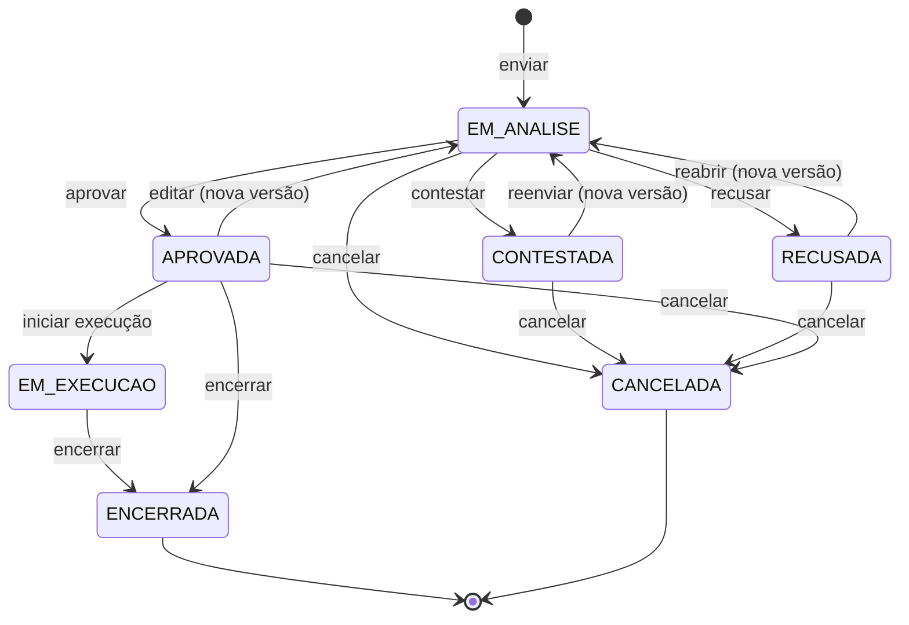

# Aggregate: Solicitação

| Campo | Valor |
| --- | --- |
| Bounded context | Aprovações |
| Status | Approved |
| Atualizado em | 2026-11-11 |
| Aprovado por / em | Leandro Nascimento / 2026-11-11 |
| Origem | Event Storming, raia D; hotspots H12, H16, H19, H21, H26 |

## 1. Propósito

Garantir que um pedido só produza efeito depois de uma decisão formal, tomada por alguém que não é o solicitante,
justificada e presa à versão exata do que foi pedido.

O aggregate não sabe do que o pedido trata. O conteúdo de cada versão pertence ao contexto que registrou o tipo de
solicitação (Financeiro ou Eventos).

## 2. Ciclo de vida

`EM_EXECUCAO` e `ENCERRADA` são comandados pelo contexto dono do tipo: o Financeiro inicia a execução quando envia o
recurso e encerra quando liquida a saída; Eventos encerra quando o evento é realizado.

## 3. Comandos aceitos

| Comando | Ator | Pré-condições | Eventos emitidos | Falhas de negócio |
| --- | --- | --- | --- | --- |
| `enviar` | Solicitante (pelo contexto dono) | Tipo registrado; se o solicitante pode decidir esse tipo, um aprovador indicado | `SolicitacaoEnviada` | `TIPO_DESCONHECIDO`, `APROVADOR_NAO_INDICADO` |
| `aprovar` | Aprovador | `EM_ANALISE`; motivo | `SolicitacaoAprovada` | `NAO_ESTA_EM_ANALISE`, `SOLICITANTE_NAO_DECIDE`, `MOTIVO_OBRIGATORIO` |
| `contestar` | Aprovador | `EM_ANALISE`; motivo e mensagem; teto sugerido só se a versão tem valor | `SolicitacaoContestada` | As de `aprovar`, mais `MENSAGEM_OBRIGATORIA`, `TETO_SEM_VALOR` |
| `recusar` | Aprovador | `EM_ANALISE`; motivo | `SolicitacaoRecusada` | As de `aprovar` |
| `reenviar` | Solicitante | `CONTESTADA`; conteúdo novo | `SolicitacaoReenviada` | `NAO_ESTA_CONTESTADA`, `SO_O_SOLICITANTE` |
| `reabrir` | Solicitante, admin ou quem tem a permissão | `RECUSADA`; justificativa; conteúdo novo opcional | `SolicitacaoReaberta` | `NAO_ESTA_RECUSADA`, `JUSTIFICATIVA_OBRIGATORIA` |
| `editar` | Solicitante | `APROVADA`; conteúdo novo | `SolicitacaoEditada` | `NAO_PODE_EDITAR` |
| `iniciar_execucao` | Contexto dono | `APROVADA` | `SolicitacaoEmExecucao` | `NAO_ESTA_APROVADA` |
| `encerrar` | Contexto dono | `APROVADA` ou `EM_EXECUCAO` | `SolicitacaoEncerrada` | `NAO_PODE_ENCERRAR` |
| `cancelar` | Solicitante, admin ou quem tem a permissão | Não está em `EM_EXECUCAO`, `ENCERRADA` nem `CANCELADA`; motivo | `SolicitacaoCancelada` | `NAO_PODE_CANCELAR`, `MOTIVO_OBRIGATORIO` |

## 4. Invariantes

| ID | Regra | Como é garantida | Teste |
| --- | --- | --- | --- |
| INV-SOL-01 | Só se decide uma solicitação `EM_ANALISE`, e a decisão vale para a versão vigente | Em `aprovar`, `contestar` e `recusar`, antes de mudar o estado | Rito 8 |
| INV-SOL-02 | O solicitante nunca decide o próprio pedido, salvo com a permissão de auto-aprovação; nesse caso a decisão fica marcada como aprovação própria | No método de decisão; a permissão é verificada pelo serviço e passada como fato | Rito 8 |
| INV-SOL-03 | Cada versão tem no máximo uma decisão | No método de decisão | Rito 8 |
| INV-SOL-04 | Toda decisão tem aprovador, motivo de decisão e momento; contestar tem também mensagem | Na criação da `Decisao` | Rito 8 |
| INV-SOL-05 | Uma versão nunca é alterada; reenviar, reabrir e editar criam a versão seguinte | Versões só são acrescentadas | Rito 8 |
| INV-SOL-06 | Decisões de versões anteriores não valem para a versão vigente | O estado volta a `EM_ANALISE` a cada versão nova | Rito 8 |
| INV-SOL-07 | Teto sugerido só existe em contestação de versão com valor, e é maior que zero | Em `contestar` | Rito 8 |
| INV-SOL-08 | `ENCERRADA` e `CANCELADA` não aceitam nenhum comando | Em todos os métodos | Rito 8 |
| INV-SOL-09 | Em `EM_EXECUCAO` a solicitação não pode ser editada nem cancelada | Em `editar` e `cancelar` | Rito 8 |
| INV-SOL-10 | Se o solicitante tem a permissão de decidir o tipo, a solicitação só é enviada com um aprovador indicado, diferente dele | Em `enviar`; o fato "solicitante pode decidir" vem do serviço | Rito 8 |
| INV-SOL-11 | O aprovador indicado decide só aquela solicitação | A indicação fica na solicitação, não vira permissão | Rito 8 |

Quem pode decidir (os usuários com a permissão para o tipo, mais o aprovador indicado) é resolvido pelo serviço, com
o contexto Identidade e Permissões. O aggregate recebe o resultado e protege o resto.

## 5. Policies corretivas

| Situação | Policy | Responsável |
| --- | --- | --- |
| Nenhum usuário além do solicitante pode decidir o tipo, e ele não indicou ninguém | A solicitação não é enviada (INV-SOL-10); o admin sempre pode decidir | Serviço de Aprovações |
| O aprovador indicado é desativado antes de decidir | A solicitação continua na fila de quem tem a permissão e do admin; o admin é notificado (hipótese, NOT-06) | Serviço de Aprovações |

## 6. Composição

| Elemento | Tipo | Observação |
| --- | --- | --- |
| `Solicitacao` | Aggregate Root | Tipo, solicitante, estado, aprovador indicado |
| `Versao` | Entity | Número sequencial, conteúdo, valor opcional, autor, momento, justificativa (em reabrir e editar); imutável depois de criada |
| `Decisao` | Entity | Versão, tipo (aprovar, contestar, recusar), aprovador, motivo aplicado, mensagem, teto sugerido, momento, marca de aprovação própria; imutável |
| `MotivoAplicado` | Value Object | ID do motivo de decisão, texto do motivo no momento (snapshot) e texto livre opcional |
| `Dinheiro` | Value Object | Decimal com duas casas, em reais, não negativo |

## 7. Referências e snapshots

| Referência | Contexto de origem | Por ID? | Snapshot (campos e quando congela) |
| --- | --- | --- | --- |
| `solicitante_id`, `aprovador_id`, `aprovador_indicado_id` | Identidade e Permissões | Sim | Nenhum |
| `motivo_id` | Aprovações (cadastro) | Sim | Texto do motivo, na decisão |
| Conteúdo da versão | Contexto dono do tipo | — | O contexto dono entrega o conteúdo já montado (itens, valores, datas); congela na criação da versão |

## 8. Volume e concorrência

- Vazão esperada: algumas por semana.
- Conflitos prováveis: dois aprovadores decidindo a mesma solicitação ao mesmo tempo; o solicitante editando enquanto
  o aprovador decide.
- Estratégia: bloqueio da linha da solicitação durante o comando; o segundo comando falha por INV-SOL-01 ou
  INV-SOL-03.

## 9. Casos de borda fechados

| Pergunta | Decisão | Data | Quem decidiu |
| --- | --- | --- | --- |
| Uma solicitação pode ter vários aprovadores? | Não. Um aprovador por versão; o que precisa de duas decisões vira duas solicitações ligadas | 2026-11-11 | Leandro Nascimento |
| O que é contestar? | Devolver para ajustes, com mensagem; o solicitante reenvia | 2026-11-11 | Leandro Nascimento |
| Sugerir teto é uma decisão à parte? | Não. É contestar com um valor sugerido | 2026-11-11 | Leandro Nascimento |
| Quem o solicitante pode indicar como aprovador? | Qualquer diretor | 2026-11-11 | Leandro Nascimento |
| Pode-se editar ou cancelar a solicitação depois que a execução começou (recurso enviado)? | Não. Ela fica `EM_EXECUCAO`; a correção é por complemento ou devolução | 2026-11-11 | Leandro Nascimento |

## 10. Perguntas em aberto

- A indicação de aprovador gera aviso ao admin e fica explícita no histórico? → H26 (proposta para o rito 6)
- Editar enquanto está `EM_ANALISE` é permitido? Proposta: não; o solicitante cancela ou espera a decisão → rito 6
- Modelagem física das versões e do conteúdo → AD-008
