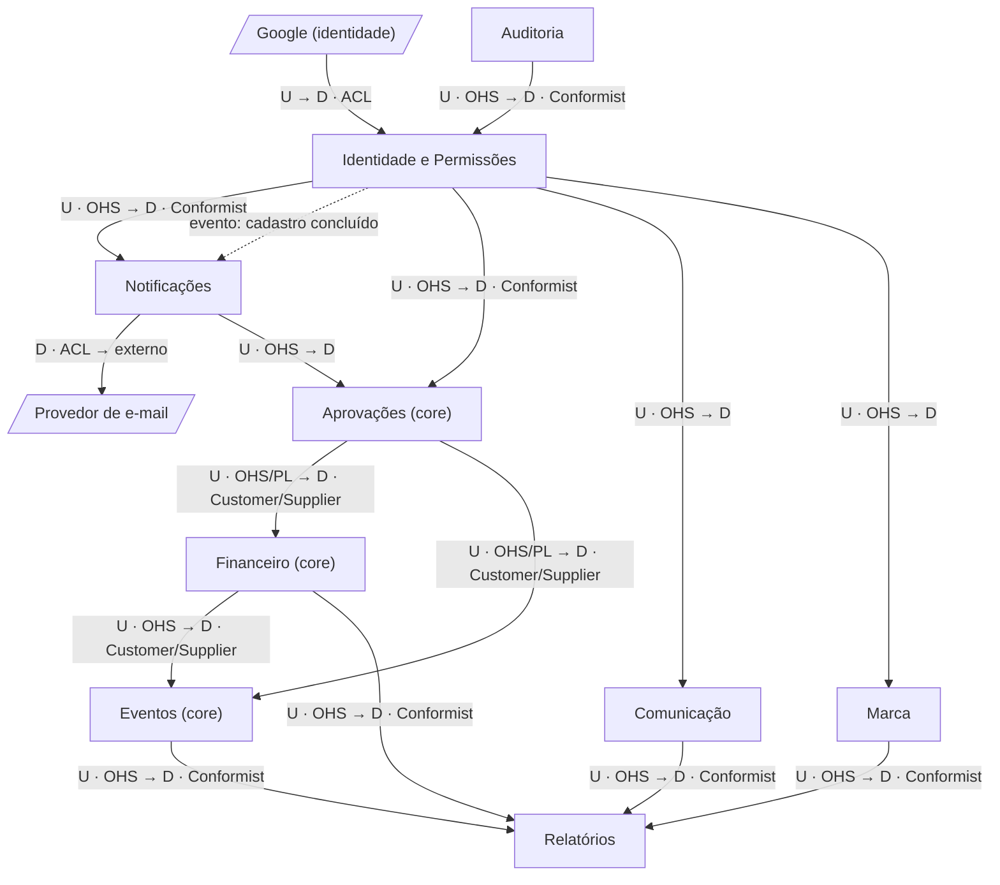

# Context map

| Campo | Valor |
| --- | --- |
| Status | Approved |
| Atualizado em | 2026-11-11 |
| Aprovado por / em | Leandro Nascimento / 2026-11-11 |
| Materialização das integrações | [ADR-003](../adr/ADR-003-integracao-entre-contextos.md) (Accepted) |
| Board | Não usa |

As setas vão do upstream (quem é conhecido) para o downstream (quem conhece). Um contexto só importa os que estão
acima dele neste desenho.

Para o desenho ficar legível, três relações que valem para todos não foram repetidas: todo contexto usa Auditoria
(registrar ação), Identidade e Permissões (checar permissão) e Notificações (avisar usuários).

## Relações

| Upstream | Downstream | Padrão | Contrato vigente | Decisão |
| --- | --- | --- | --- | --- |
| Google | Identidade e Permissões | ACL | Validação do login social; o modelo do Google não entra no domínio | AD-006 |
| Auditoria | Todos | OHS → Conformist | API em processo: registrar ação; consultar histórico de um item | ADR-003, AD-009 |
| Identidade e Permissões | Todos | OHS → Conformist | API em processo: "pode fazer?", "quem pode fazer?", dados básicos do usuário | ADR-003, AD-007 |
| Identidade e Permissões | Notificações | PL (evento em processo) | Evento "cadastro concluído", para avisar o admin | ADR-003 |
| Notificações | Aprovações, Financeiro, Eventos, Comunicação | OHS | API em processo: notificar usuários sobre um item | ADR-003 |
| Notificações | Provedor de e-mail | ACL | Port de e-mail | AD-012 |
| Aprovações | Financeiro, Eventos | OHS/PL → Customer/Supplier | API em processo: abrir solicitação de um tipo registrado. Eventos em processo: solicitação aprovada, contestada, recusada, cancelada | ADR-003, AD-008 |
| Financeiro | Eventos | OHS → Customer/Supplier | API em processo: abrir solicitação orçamentária para um evento; consultar a situação do orçamento | ADR-003 |
| Financeiro, Eventos, Comunicação, Marca | Relatórios | OHS → Conformist | APIs públicas de consulta | ADR-003 |

Aprovações é o fornecedor de Financeiro e de Eventos: os dois são os clientes que definem o que o motor precisa
oferecer. Aprovações nunca importa nenhum deles.

## Observações

- 2026-11-11: primeira versão, a partir da descoberta simplificada do core. Os contextos de apoio vêm do enunciado,
  sem história narrada.
