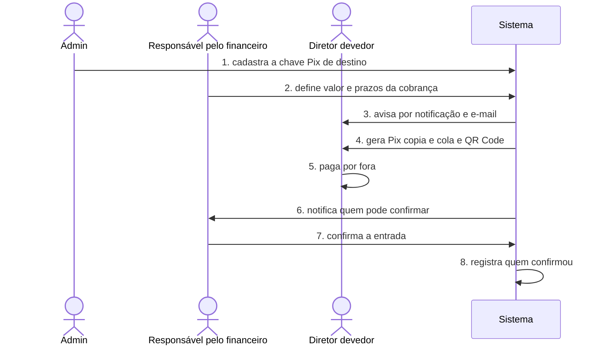
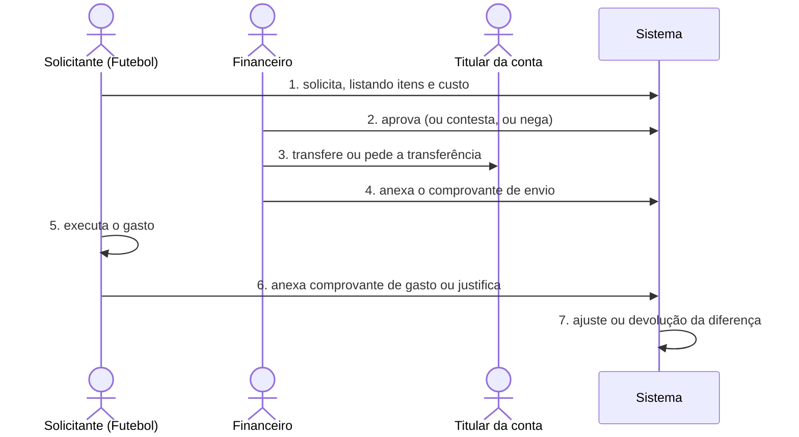
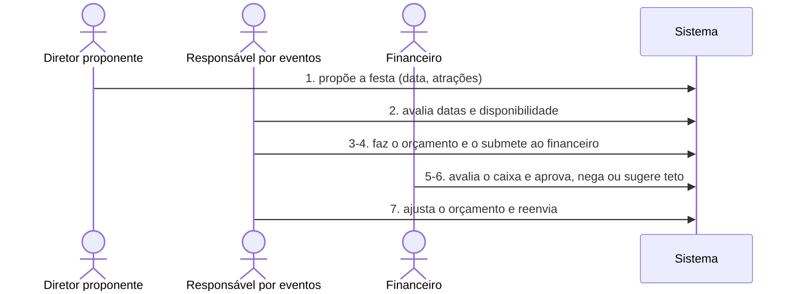

# Domain Storytelling: fluxos do core

| Campo | Valor |
| --- | --- |
| Status | Revisado por Leandro Nascimento em 2026-11-11 |
| Narrado por | Leandro Nascimento |
| Registrado em | 2026-11-11 |
| Board | Não usa (Miro ainda não conectado à sessão) |

Rito 3 em modo simplificado: entrevista guiada sobre cobrança, saída, solicitação com aprovação e evento.

## Escopo da história

| Dimensão | Escolha |
| --- | --- |
| Granularidade | Fina (um fluxo por história) |
| Momento | To-be (como será com o sistema) |
| Pureza | Digitalizada (com o sistema) |

## Atores

| Ator | Quem é | Observação |
| --- | --- | --- |
| Admin | Gestor do sistema | Cadastra a chave Pix de destino; pode atribuir regras avulsas a qualquer usuário |
| Responsável pelo financeiro | Usuário com o privilégio de definir cobranças e de confirmar entradas | O privilégio vem, em regra, do setor Financeiro, mas o admin pode dá-lo a alguém de outro setor ou cargo |
| Diretor devedor | Diretor de quem a cobrança é esperada | |
| Sistema | Club Manager | Notifica, gera o Pix copia e cola e o QR Code, registra quem confirmou |

## Objetos de trabalho

| Objeto | O que é para o negócio |
| --- | --- |
| Cobrança | Valor e prazo definidos para um diretor |
| Chave Pix de destino | Chave previamente cadastrada pelo admin, para onde o diretor paga |
| Pix copia e cola e QR Code | Meio de pagamento gerado pelo sistema a partir da chave |
| Confirmação | Registro de que alguém com a permissão conferiu que o valor entrou |
| Notificação | Aviso por e-mail e na caixa do site |

## História 1 — Mensalidade paga e confirmada (caminho feliz)

1. O admin cadastra a chave Pix de destino.
2. O admin, ou o responsável pelo financeiro, define o valor e os prazos da cobrança.
3. O sistema avisa o diretor devedor por notificação e por e-mail.
4. O sistema gera o Pix copia e cola e o QR Code da cobrança.
5. O diretor devedor paga por fora, usando o Pix.
6. O sistema notifica quem tem a permissão de confirmar aquela entrada.
7. Um usuário com essa permissão confirma a entrada.
8. O sistema registra quem confirmou.

Regra dita pelo dono nesta história: quem tem a permissão de confirmar uma entrada, um evento ou uma ação recebe a
notificação correspondente. A permissão vem das regras do setor (as do Financeiro permitem aprovar operações
financeiras), e o admin pode atribuir regras avulsas a um usuário de outro contexto, setor ou cargo.

## História 2 — Pagamento registrado pelo diretor e aprovado manualmente (detalhe da confirmação)

Na primeira versão, a aprovação do pagamento é manual.

1. O diretor devedor paga por fora.
2. O diretor devedor registra o pagamento, anexa o comprovante e sinaliza o envio.
3. O sistema coloca o pagamento em processamento.
4. O sistema notifica o setor responsável ou o usuário responsável.
5. O responsável confere o comprovante e confere na conta se o recebimento de fato aconteceu.
6. O responsável aprova o pagamento, justificando com uma das opções (por exemplo, "conferido em conta pelo
   titular").
7. O sistema registra a aprovação de forma rastreável.

Variação — dinheiro recebido em mão:

1. O diretor devedor entrega o dinheiro em mão a uma pessoa.
2. O diretor devedor registra o pagamento sem comprovante e indica a pessoa que recebeu o dinheiro.
3. O responsável pode consultar essa pessoa.
4. O responsável aprova o pagamento com a justificativa "dinheiro recebido em mão".

## História 3 — Pagamento reprovado (exceção)

1. O responsável confere o comprovante e a conta e não encontra o recebimento.
2. O responsável reprova o pagamento, com justificativa.
3. O sistema registra a reprovação.
4. O sistema notifica o diretor devedor para refazer o processo.
5. O diretor devedor registra o pagamento de novo (história 2).

## História 4 — Cobrança em atraso e inadimplência (exceção)

1. O admin, ou o responsável pelo financeiro, cria a cobrança (mensalidade ou outro tipo) e define nela um limite de
   tempo de inadimplência.
2. O prazo da cobrança vence sem pagamento aprovado.
3. O sistema passa a cobrança para o estado de atrasada.
4. O sistema notifica o diretor devedor e o responsável.
5. O limite de tempo de inadimplência acaba.
6. O sistema notifica o diretor devedor e o financeiro, para a convocação do devedor.
7. O diretor devedor justifica as faltas.
8. Os responsáveis decidem: a dívida é extinta, como perdão, ou é renegociada.

## História 5 — Solicitação de gasto do Futebol (caminho feliz)

Exemplos dados pelo dono: taxa de um campeonato, taxa de arbitragem de um jogo, gasto operacional da partida,
pagamento por jogadores.

1. Um responsável pelo Futebol faz a solicitação, listando os itens e o custo na descrição.
2. O financeiro, ou o responsável, aprova, contesta ou nega a solicitação.
3. Aprovada, o financeiro faz a transferência, ou pede ao titular da conta que a faça.
4. O financeiro recebe o comprovante de envio e o anexa.
5. O solicitante executa o gasto.
6. O solicitante anexa o comprovante de gasto, se tiver, ou justifica por escrito.
7. A diferença entre o valor enviado e o gasto pode gerar um ajuste ou a devolução da diferença.

## História 6 — Solicitação contestada ou recusada (exceção)

1. O solicitante envia uma solicitação com valores irreais ou sem justificativa plausível.
2. O responsável contesta a solicitação, para ajustes, ou a recusa, escrevendo uma mensagem.
3. O sistema notifica o solicitante, por notificação e e-mail, com um texto padrão e a mensagem do responsável.
4. O solicitante corrige e reenvia a solicitação.
5. O responsável avalia de novo.

Regras ditas pelo dono nesta história:

- Uma aprovação basta, a princípio, e ela tem de ser rastreável. Casos que precisem de dois ou mais setores terão
  regras criadas para isso.
- Se o próprio financeiro é o solicitante, ele precisa indicar um aprovador; ou o admin, ou um usuário com permissão
  para isso, avalia.
- Gasto maior que o aprovado precisa de nova aprovação.

## História 7 — Cobrança contestada pelo devedor (exceção)

1. O diretor devedor pede uma isenção, ou a suspensão de um débito ou de cobranças futuras.
2. Por algum motivo, o responsável não faz o ajuste no sistema.
3. O sistema gera a cobrança.
4. O diretor devedor contesta a cobrança.
5. A diretoria analisa a contestação.
6. Se a decisão for a favor do devedor, a cobrança é cancelada.

## História 8 — Evento com custo: duas solicitações distintas (caminho feliz)

Exemplo dado pelo dono: uma festa.

1. Um diretor propõe uma festa, com data e atrações.
2. O responsável por eventos avalia as datas e a disponibilidade.
3. O responsável por eventos faz o orçamento.
4. O responsável por eventos submete o orçamento, como uma solicitação, ao setor financeiro.
5. O financeiro avalia a saúde do caixa.
6. O financeiro aprova, não aprova, ou sugere um teto de gasto.
7. Com um teto sugerido, o orçamento é ajustado e volta para outra rodada, em que pode ser aceito ou não.

Regras ditas pelo dono nesta história:

- Cada solicitação tem um só validador. Uma solicitação financeira é aprovada por quem tem esse privilégio (é do
  setor Financeiro ou tem a regra de aprovar operações financeiras). Uma operação de eventos é aprovada pelo
  responsável de eventos.
- Um evento com custo gera **duas solicitações distintas**: uma para aprovar o evento e outra orçamentária. Não é uma
  solicitação única com dois validadores.

## História 9 — Evento aprovado, realizado ou cancelado

1. O evento é aprovado.
2. O sistema coloca o evento no calendário, que é compartilhado por todos.
3. O sistema notifica todos sobre o evento.
4. O responsável confirma que o evento aconteceu.

Variação — cancelamento:

1. O evento é cancelado, com justificativa.
2. O sistema tira o evento do calendário.
3. O sistema notifica todos sobre o cancelamento.

## Termos novos

| Termo | Como o negócio usou | Vai para a linguagem ubíqua? |
| --- | --- | --- |
| Confirmar (uma entrada) | "quem confirma é o usuário responsável com a role que permite isso" | A decidir no rito 4: o enunciado usa "validar"; unir os sinônimos |
| Role, privilégio, regra | Usados como sinônimos de permissão | A decidir no rito 4: o enunciado usa "permissão (regra)" |
| Em processamento | "até o responsável aprovar, o pagamento fica em processamento" | A decidir no rito 4: o enunciado usa "pendente de validação" |
| Aprovar o pagamento | "valida o comprovante e a conta [...] e aprova o pagamento" | A decidir no rito 4: mesmo ato que "confirmar" e "validar"; não confundir com a aprovação de solicitações |
| Reprovar (o pagamento) | "ele reprova a cobrança com a justificativa" | A decidir no rito 4: o enunciado usa "recusa de comprovante" (FIN-08) |
| Limite de tempo de inadimplência | "coloca um limite de tempo de inadimplência" na criação da cobrança | Sim: conceito novo, não está no enunciado |
| Convocação | "convocação desse devedor [para] justificar as faltas" | Sim: conceito novo |
| Perdão | "a dívida é extinta como perdão" | A decidir no rito 4: relação com isenção e cancelamento (H08) |
| Renegociação | "ou renegociada" | Sim: conceito novo (H09) |
| Contestar (uma solicitação) | "pode ser contestada para ajustes ou recusada" | Sim: terceira decisão, que devolve a solicitação ao solicitante para ajustes; não está no enunciado |
| Contestar (uma cobrança) | "a cobrança é gerada e pode ser contestada" pelo devedor | A decidir no rito 4: o enunciado chama de "questionamento" (FIN-10); o mesmo verbo tem dois sentidos |
| Suspensão (de débito ou de cobranças futuras) | "solicitado uma isenção ou suspensão de um débito ou de cobranças futuras" | A definir: diferença para isenção (H17) |
| Diretoria | "é analisada pela diretoria" | A definir: quem decide na prática (H18) |
| Comprovante de envio | "recebe e anexa o comprovante de envio" | Sim (FIN-15) |
| Comprovante de gasto | "anexa o comprovante de gasto caso tenha ou justifica por escrito" | Sim (FIN-16, prestação de contas) |
| Ajuste e devolução da diferença | "podendo gerar um ajuste ou devolução da diferença de valor" | Sim (H13) |
| Solicitação orçamentária | "uma a aprovar o evento e outra orçamentária" | Sim |
| Orçamento | "faz o orçamento e submete esse orçamento a uma solicitação ao setor financeiro" | Sim |
| Teto de gasto | "sugere um teto de gasto para que o orçamento seja ajustado" | Sim: conceito novo |
| Saúde do caixa | "avalia a saúde do caixa" | Sim: informação que o aprovador financeiro precisa ver para decidir |
| Titular | "conferido em conta pelo titular" | Sim: o dono da conta bancária para onde o dinheiro vai |
| Recebido em mão | "dinheiro recebido em mão, que nesse caso não gera comprovante" | Sim |
| Chave Pix de destino | "o pix de destino é previamente cadastrado pelo adm" | Sim |
| Pix copia e cola | "gera um copia e cola e qrcode" | Sim |

## Perguntas que surgiram

- A chave Pix é uma só para o clube, ou pode variar por categoria ou por cobrança? O QR Code já leva o valor? → H01
- Entre o passo 5 e o 6, o diretor registra o pagamento e anexa o comprovante (FIN-05), ou a confirmação parte só de
  quem confere a conta? → H02 (resolvido pela história 2)
- O recibo ao pagador depois da confirmação entra? → H03
- As opções de justificativa da aprovação são uma lista fixa ou o admin as cadastra? Há texto livre além da opção? → H04
- No dinheiro em mão, a pessoa que recebeu precisa ser um usuário do sistema? Ela confirma algo no sistema, ou o
  responsável a consulta por fora? → H05
- Como termina a cobrança em atraso? E o que acontece quando o responsável confere e o dinheiro não está na conta? → H06
  (resolvido pelas histórias 3 e 4)
- Perdão é o mesmo que isenção ou cancelamento (FIN-10, FIN-11), ou é um terceiro desfecho? → H08
- O que muda numa renegociação: novo valor, novo prazo, parcelas? A cobrança original é encerrada e nasce outra? → H09
- A convocação e a justificativa do devedor acontecem dentro do sistema? Como ela se relaciona com o questionamento
  (FIN-10), que parte do devedor? E se não houver perdão nem renegociação? → H10
- O que é contestar: devolver ao solicitante para corrigir, sem recusar? Quem responde, e o que acontece depois? → H12
- Como funcionam o ajuste e a devolução: gasto menor gera uma entrada de devolução? Gasto maior precisa de nova
  aprovação? → H13
- Os itens da solicitação são uma lista estruturada (item e valor) ou texto livre na descrição? → H14
- Quem dá a saída por encerrada (liquidada), e em que momento: ao receber a prestação de contas, ou depois de alguém
  conferi-la? → H15
- O que é contestar → H12 (resolvido pela história 6)
- Gasto maior precisa de nova aprovação (resolve parte do H13); falta o caso do gasto menor.
- "Uma aprovação basta, a princípio": o motor já nasce com aprovação por vários setores (APR-03, APR-04), ou isso fica
  para quando surgir o primeiro caso? → H16 (resolvido pela história 8)
- Qual a diferença entre suspensão e isenção? O devedor pede isenção ou suspensão pelo sistema? → H17
- "Analisada pela diretoria": é o responsável financeiro, um grupo, uma votação? → H18
- Quando o financeiro é o solicitante, ele escolhe o aprovador livremente, ou só entre quem já tem a permissão? → H19
- A aprovação do evento depende da aprovação do orçamento? Se o orçamento for negado, o que acontece com o evento, e
  quando ele entra no calendário? → H20
- Sugerir um teto de gasto é o mesmo ato que contestar para ajustes (história 6), com um valor sugerido? → H21
- O orçamento é feito pelo responsável por eventos, e não por quem propôs: o proponente e o solicitante do orçamento
  são pessoas diferentes? → H22
- Mudança de data de um evento aprovado: precisa de nova aprovação? Todos são notificados? → H24
- "Todos recebem uma notificação" do evento aprovado e do cancelamento: o enunciado (NOT-06) não lista esses avisos;
  entram como requisito novo → H25
