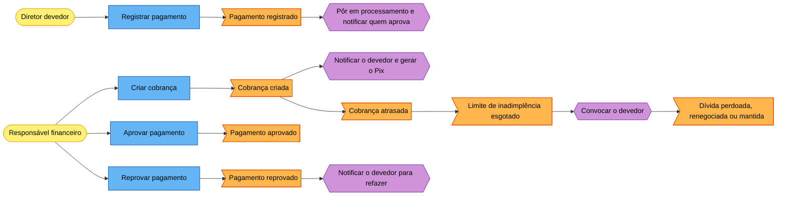
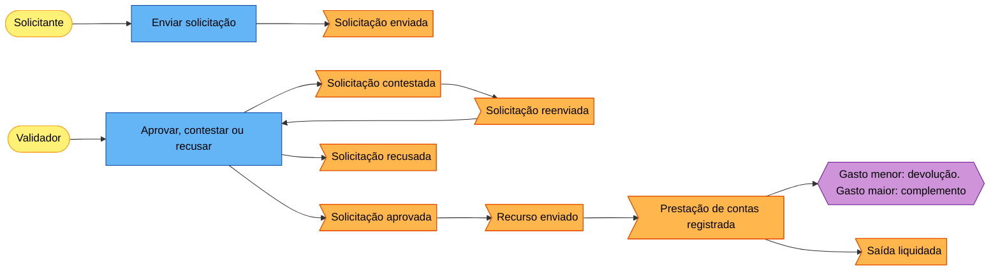

# Event Storming: fluxos do core

| Campo | Valor |
| --- | --- |
| Tipo | Processo: cobrança, saída, solicitação e evento (modo simplificado, por entrevista) |
| Status | Revisado por Leandro Nascimento em 2026-11-11 |
| Participantes | Leandro Nascimento + Claude |
| Data | 2026-11-11 |
| Board | Não usa |

Os eventos vêm das histórias de `domain-storytelling.md` e das respostas aos hotspots. O que vem só do enunciado, sem
ter sido narrado, está marcado como **(hipótese)**.

## 1. Exploração caótica

Eventos levantados, na ordem em que apareceram na entrevista:

- Chave Pix cadastrada
- Cobrança definida (valor e prazos)
- Diretor avisado da cobrança
- Pix copia e cola e QR Code gerados
- Entrada confirmada
- Confirmação registrada
- Pagamento registrado, com comprovante, e envio sinalizado
- Pagamento em processamento
- Pagamento aprovado, com motivo escolhido
- Dinheiro recebido em mão, com o recebedor indicado
- Cobrança atrasada
- Pagamento reprovado
- Limite de inadimplência esgotado
- Devedor convocado
- Faltas justificadas
- Dívida perdoada
- Dívida renegociada
- Solicitação de gasto feita, com itens e custo
- Solicitação aprovada, contestada ou negada
- Transferência feita
- Comprovante de envio anexado
- Comprovante de gasto anexado, ou gasto justificado por escrito
- Diferença ajustada ou devolvida
- Solicitação corrigida e reenviada
- Aprovador indicado pelo solicitante
- Isenção ou suspensão pedida
- Cobrança contestada pelo devedor
- Cobrança cancelada
- Festa proposta
- Datas e disponibilidade avaliadas
- Orçamento feito e submetido ao financeiro
- Teto de gasto sugerido
- Evento aprovado
- Evento colocado no calendário
- Todos notificados do evento
- Acontecimento confirmado
- Evento cancelado, com justificativa

## 2. Linha do tempo

Os termos vencedores são provisórios: a linguagem ubíqua é fechada no rito 4.

### Raia A — Cobrança e recebimento

| # | Evento | Sinônimos unidos | Termo vencedor (provisório) |
| --- | --- | --- | --- |
| A1 | Chave Pix cadastrada | pix de destino cadastrado | Chave Pix cadastrada |
| A2 | Cobrança criada | cobrança definida, cobrança gerada (pela recorrência) | Cobrança criada |
| A3 | Devedor notificado da cobrança | diretor avisado | Cobrança notificada |
| A4 | Pagamento registrado | envio sinalizado, comprovante anexado, dinheiro recebido em mão | Pagamento registrado |
| A5 | Pagamento aprovado | entrada confirmada, pagamento validado, confirmação registrada | Pagamento aprovado |
| A6 | Recibo emitido | — | Recibo emitido |
| A7 | Pagamento reprovado | comprovante recusado | Pagamento reprovado |

### Raia B — Atraso e inadimplência

| # | Evento | Sinônimos unidos | Termo vencedor (provisório) |
| --- | --- | --- | --- |
| B1 | Cobrança vencida | cobrança atrasada, em atraso | Cobrança atrasada |
| B2 | Limite de inadimplência esgotado | — | Limite de inadimplência esgotado |
| B3 | Devedor convocado | — | Devedor convocado |
| B4 | Justificativa do devedor registrada | faltas justificadas | Justificativa registrada |
| B5 | Dívida perdoada | dívida extinta | Dívida perdoada |
| B6 | Dívida renegociada | — | Dívida renegociada |
| B7 | Parcelas geradas | — | Parcelas geradas |
| B8 | Dívida mantida | — | Dívida mantida |

### Raia C — Contestação, isenção e suspensão

| # | Evento | Sinônimos unidos | Termo vencedor (provisório) |
| --- | --- | --- | --- |
| C1 | Cobrança contestada pelo devedor | cobrança questionada | Cobrança contestada |
| C2 | Contestação decidida a favor: cobrança cancelada | — | Cobrança cancelada |
| C3 | Contestação decidida contra: cobrança mantida **(hipótese, FIN-10)** | — | Contestação negada |
| C4 | Cobrança isenta **(hipótese, FIN-11)** | — | Cobrança isenta |
| C5 | Cobranças futuras suspensas | suspensão de débito | Cobranças suspensas |
| C6 | Suspensão encerrada **(hipótese)** | — | Suspensão encerrada |

### Raia D — Solicitação e decisão

| # | Evento | Sinônimos unidos | Termo vencedor (provisório) |
| --- | --- | --- | --- |
| D1 | Solicitação enviada | pedido feito, orçamento submetido, evento proposto | Solicitação enviada |
| D2 | Aprovador indicado | "setar um aprovador" | Aprovador indicado |
| D3 | Solicitação aprovada | — | Solicitação aprovada |
| D4 | Solicitação contestada | devolvida para ajustes, teto de gasto sugerido | Solicitação contestada |
| D5 | Solicitação recusada | negada | Solicitação recusada |
| D6 | Solicitação reenviada | corrigida e reenviada, nova rodada | Solicitação reenviada (nova versão) |
| D7 | Solicitação reaberta **(hipótese, APR-06)** | — | Solicitação reaberta |
| D8 | Solicitação cancelada **(hipótese, APR-10)** | — | Solicitação cancelada |

### Raia E — Execução do gasto e prestação de contas

| # | Evento | Sinônimos unidos | Termo vencedor (provisório) |
| --- | --- | --- | --- |
| E1 | Recurso enviado | transferência feita, comprovante de envio anexado | Recurso enviado |
| E2 | Prestação de contas registrada | comprovante de gasto anexado, gasto justificado por escrito | Prestação de contas registrada |
| E3 | Devolução registrada | diferença devolvida | Devolução registrada |
| E4 | Devolução confirmada | — | Devolução confirmada |
| E5 | Complemento solicitado | ajuste, gasto maior | Complemento solicitado |
| E6 | Saída liquidada | saída encerrada | Saída liquidada |
| E7 | Saída estornada **(hipótese, FIN-18)** | — | Saída estornada |

### Raia F — Evento

| # | Evento | Sinônimos unidos | Termo vencedor (provisório) |
| --- | --- | --- | --- |
| F1 | Evento proposto | festa proposta | Evento proposto |
| F2 | Evento aprovado | datas e disponibilidade avaliadas | Evento aprovado |
| F3 | Orçamento do evento aprovado | — | Orçamento aprovado |
| F4 | Evento publicado no calendário | colocado no calendário | Evento publicado |
| F5 | Todos notificados do evento | — | Evento divulgado |
| F6 | Evento editado | data alterada | Evento editado |
| F7 | Evento retirado do calendário | — | Evento despublicado |
| F8 | Evento realizado | acontecimento confirmado | Evento realizado |
| F9 | Evento cancelado | — | Evento cancelado |

## 3. Hotspots

Ver `hotspots.md`. Resumo: 30 hotspots, todos com destino definido; 22 resolvidos na entrevista e 8 encaminhados
(requisitos novos, refinamento de marco ou decisão).

## 4. Eventos pivotais e raias

| Evento pivotal | Fase que encerra | Fase que inicia |
| --- | --- | --- |
| Cobrança criada | Definição | Espera do pagamento |
| Pagamento registrado | Espera do pagamento | Conferência |
| Pagamento aprovado | Conferência | Encerrada (paga) |
| Limite de inadimplência esgotado | Atraso | Convocação e decisão sobre a dívida |
| Solicitação aprovada | Decisão | Execução (envio do recurso ou publicação do evento) |
| Recurso enviado | Execução financeira | Prestação de contas |
| Saída liquidada | Prestação de contas | Encerrada (imutável) |
| Evento publicado | Aprovação do evento | Espera da data |
| Evento realizado | Espera da data | Encerrado (imutável) |

Raias identificadas: cobrança e recebimento; atraso e inadimplência; contestação, isenção e suspensão; solicitação e
decisão; execução do gasto e prestação de contas; evento.

A raia D (solicitação e decisão) atravessa as raias E e F: o mesmo ciclo de enviar, decidir e reenviar serve ao gasto,
ao orçamento e ao evento. É a evidência do motor de aprovações como contexto próprio.

## 5. Atores, comandos, policies, read models e sistemas externos

| # | Evento | Ator | Comando | Policy disparada | Read model | Sistema externo |
| --- | --- | --- | --- | --- | --- | --- |
| A1 | Chave Pix cadastrada | Admin | Cadastrar chave Pix | — | Chaves Pix | — |
| A2 | Cobrança criada | Admin, responsável financeiro, ou o agendador | Criar cobrança (valor, vencimento, limite de inadimplência, chave Pix) | Sempre que criada, notificar o devedor e gerar o Pix copia e cola e o QR Code. Não criar se o diretor tiver suspensão vigente | Cobranças do devedor | — |
| A4 | Pagamento registrado | Diretor devedor | Registrar pagamento (comprovante, ou "em mão" com o recebedor) | Sempre que registrado, pôr a cobrança em processamento e notificar quem pode aprovar pagamentos | Pagamentos a conferir | Banco (por fora) |
| A5 | Pagamento aprovado | Quem tem a permissão | Aprovar pagamento (motivo + texto opcional) | Sempre que aprovado, marcar a cobrança como paga, notificar o devedor e disponibilizar o recibo | Comprovante, dados do recebedor, histórico da cobrança | Banco (conferência por fora) |
| A7 | Pagamento reprovado | Quem tem a permissão | Reprovar pagamento (motivo) | Sempre que reprovado, devolver a cobrança ao estado anterior e notificar o devedor para refazer | Idem | — |
| B1 | Cobrança atrasada | Agendador | — | Sempre que o vencimento passar sem pagamento aprovado, marcar como atrasada e notificar o devedor e o responsável | Inadimplência | — |
| B2 | Limite de inadimplência esgotado | Agendador | — | Sempre que o limite acabar, convocar o devedor e notificar o financeiro | Inadimplência | — |
| B4 | Justificativa registrada | Diretor devedor | Justificar a dívida | Sempre que registrada, notificar quem decide | Convocações pendentes | — |
| B5, B6, B8 | Dívida perdoada, renegociada ou mantida | Quem tem a permissão | Perdoar, renegociar (parcelas) ou manter | Sempre que renegociada, encerrar a cobrança original e gerar as parcelas ligadas a ela | Histórico da cobrança, justificativa do devedor | — |
| C1 | Cobrança contestada | Diretor devedor | Contestar cobrança (texto) | Sempre que contestada, notificar quem decide e pausar os avisos de atraso **(hipótese, FIN-10)** | Contestações pendentes | — |
| C2, C3 | Contestação decidida | Quem tem a permissão | Cancelar ou manter a cobrança (motivo) | Sempre que decidida, notificar o devedor | Histórico da cobrança | — |
| C5 | Cobranças suspensas | Quem tem a permissão | Suspender cobranças futuras de um diretor | Enquanto vigente, o agendador não gera as cobranças recorrentes dele | Suspensões e isenções | — |
| D1 | Solicitação enviada | Solicitante | Enviar solicitação | Sempre que enviada, notificar quem pode decidir aquele tipo. Se o solicitante for quem decidiria, exigir a indicação de um aprovador | Fila de pendências do aprovador | — |
| D3 | Solicitação aprovada | Validador (um só por solicitação) | Aprovar (motivo + texto opcional) | Sempre que aprovada, notificar o solicitante e avisar o módulo dono do tipo (financeiro ou eventos) | Itens e valores, saúde do caixa, versões anteriores | — |
| D4 | Solicitação contestada | Validador | Contestar (mensagem, teto sugerido opcional) | Sempre que contestada, notificar o solicitante com texto padrão e a mensagem | Idem | — |
| D5 | Solicitação recusada | Validador | Recusar (motivo) | Sempre que recusada, notificar o solicitante | Idem | — |
| D6 | Solicitação reenviada | Solicitante | Corrigir e reenviar | Sempre que reenviada, criar nova versão e voltar à fila do validador | Mensagem da contestação | — |
| E1 | Recurso enviado | Financeiro | Registrar envio (comprovante de envio) | Sempre que enviado, notificar o solicitante e abrir a prestação de contas | Solicitações aprovadas a pagar | Titular da conta, banco (por fora) |
| E2 | Prestação de contas registrada | Solicitante | Prestar contas (comprovante de gasto ou justificativa, valor gasto) | Se gasto menor, exigir a devolução; se maior, exigir solicitação de complemento; notificar o financeiro | Prestações pendentes | — |
| E3, E4 | Devolução registrada e confirmada | Solicitante; financeiro | Registrar devolução; aprovar o pagamento da devolução | A devolução é uma entrada ligada à saída e segue a raia A | Idem | Banco (por fora) |
| E6 | Saída liquidada | Financeiro | Conferir e liquidar | Sempre que liquidada, o registro fica imutável | Prestação de contas, devoluções | — |
| F1 | Evento proposto | Diretor com permissão | Propor evento | Cria a solicitação do evento (raia D) | Calendário, para ver disponibilidade | — |
| F2, F3 | Evento e orçamento aprovados | Responsável por eventos; financeiro | Aprovar (raia D) | Sempre que as solicitações exigidas estiverem aprovadas, publicar o evento | — | — |
| F4, F5 | Evento publicado e divulgado | Sistema | — | Sempre que publicado, notificar todos os diretores | Calendário | — |
| F6, F7 | Evento editado e despublicado | Proponente ou responsável | Editar evento | Sempre que um evento aprovado for editado, tirá-lo do calendário e voltar à aprovação | — | — |
| F8 | Evento realizado | Proponente, responsável por eventos ou admin | Confirmar realização | No dia do evento, o agendador notifica quem pode confirmar. Realizado, fica imutável | Eventos do dia | — |
| F9 | Evento cancelado | Solicitante, admin ou quem tem a permissão | Cancelar evento (motivo) | Sempre que cancelado, tirar do calendário e notificar todos | — | — |

Fluxo da cobrança:

Fluxo da solicitação de gasto:

## 6. Aggregates candidatos

Candidatos; o desenho tático (rito 5) confirma.

| Candidato | Comandos que recebe | Eventos que emite | Regra que protege |
| --- | --- | --- | --- |
| Cobrança | Criar, registrar pagamento, aprovar ou reprovar pagamento, contestar, decidir contestação, isentar, justificar dívida, perdoar, renegociar, manter | A2 a A7, B1 a B8, C1 a C4 | Só um desfecho final (paga, perdoada, isenta, cancelada, renegociada); encerrada, não muda mais; pagamento só é aprovado por quem não é o devedor **(hipótese)** |
| Renegociação | Renegociar | B6, B7 | As parcelas somam o valor acordado e ficam ligadas à cobrança original |
| Suspensão de cobranças | Suspender, encerrar suspensão | C5, C6 | Enquanto vigente, nenhuma cobrança recorrente é gerada para o diretor |
| Solicitação | Enviar, indicar aprovador, aprovar, contestar, recusar, reenviar, reabrir, cancelar | D1 a D8 | Um só validador por solicitação; o solicitante não decide o próprio pedido; cada reenvio é uma versão nova, e as decisões valem só para a versão em que foram tomadas |
| Saída | Registrar envio, prestar contas, registrar devolução, solicitar complemento, liquidar, estornar | E1 a E7 | Só nasce de solicitação aprovada; valor enviado não passa do aprovado; liquidada é imutável; só liquida com a prestação de contas conferida |
| Evento | Propor, editar, publicar, confirmar realização, cancelar | F1 a F9 | Só está no calendário com todas as solicitações exigidas aprovadas; editar um aprovado o tira do calendário; realizado é imutável |

Fora do core, como cadastro de apoio: chave Pix, motivos de decisão, categorias.

## Observações

**Mudanças em relação ao enunciado**, a levar ao registro de requisitos (rito 6) como alterações do plano:

| Mudança | Requisitos do enunciado afetados |
| --- | --- |
| Um só validador por solicitação; evento com custo gera duas solicitações ligadas, em vez de uma solicitação aprovada por vários setores | APR-03, APR-04, EVT-02, EVT-03 |
| Contestar como terceira decisão, com teto de gasto sugerido opcional | APR-04, APR-05 |
| Motivos de decisão em lista cadastrada pelo admin, com texto opcional, em toda decisão | APR-05, FIN-05, FIN-08 |
| Quem decidiria o próprio pedido indica qualquer diretor como aprovador daquele pedido | APR-02 |
| Limite de inadimplência por cobrança, convocação, perdão, renegociação em parcelas | FIN-09 (novos) |
| Suspensão de cobranças futuras, distinta de isenção | FIN-11 (novo) |
| Várias chaves Pix, Pix copia e cola e QR Code com valor, recibo em PDF | Novos (AD-016) |
| Pagamento em dinheiro, com o recebedor indicado | FIN-06 |
| Itens estruturados na solicitação de gasto | FIN-13 |
| Devolução como entrada ligada à saída; gasto maior exige nova aprovação; liquidação só depois da conferência do financeiro | FIN-16, FIN-17 |
| Notificar todos os diretores de evento aprovado e de evento cancelado | NOT-06 |
| Proponente, responsável por eventos ou admin confirmam a realização | EVT-07 |

**Para o desenho estratégico (rito 4):**

- Escolher os termos vencedores entre validar, confirmar e aprovar (pagamento); questionar e contestar (cobrança);
  permissão, regra, role e privilégio.
- "Contestar" tem dois sentidos: o validador contesta uma solicitação, e o devedor contesta uma cobrança.
- Decidir se a saída é parte do contexto financeiro, usando a solicitação do contexto de aprovações, e como o evento
  se liga à solicitação orçamentária.
