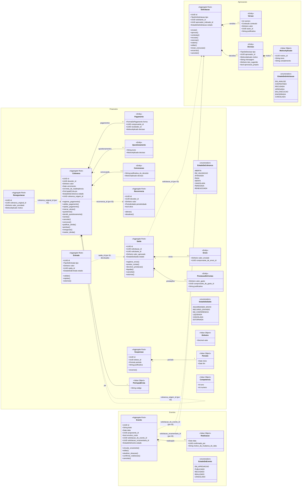

# Modelo de domínio

| Campo | Valor |
| --- | --- |
| Status | Approved |
| Atualizado em | 2026-11-11 |
| Aprovado por / em | Leandro Nascimento / 2026-11-11 |
| Auditado contra o código em | Ainda não implementado |

Antes da implementação, este diagrama é o alvo. Depois, o código é a fonte da verdade e o diagrama é auditado contra
ele a cada marco. Cobre só os três contextos core; os contextos de apoio ficam em camadas, sem modelo tático
(ADR-001).

## Legenda

| Notação | Significado |
| --- | --- |
| `*--` | Faz parte do aggregate (mesma transação) |
| `..>` | Referência por ID a outro aggregate |
| `<<Value Object>>` | Imutável, validado na criação, sem identidade |

## Value objects

| Value object | Regra de formação | Usado em |
| --- | --- | --- |
| `Dinheiro` | Decimal com duas casas, em reais; nunca ponto flutuante; não negativo | Todos os valores |
| `MotivoAplicado` | ID do motivo de decisão, texto do motivo no momento da decisão e texto livre opcional | Toda decisão |
| `PixCopiaECola` | Código de pagamento gerado a partir da chave Pix, do valor e do identificador da cobrança | Cobrança |
| `Periodo` | Início e fim opcional; o fim não é anterior ao início | Suspensão |
| `Competencia` | Período de referência de uma cobrança recorrente, calculado da periodicidade e da data | Recorrência, Cobrança |
| `Realizacao` | Data em que o evento aconteceu, quem confirmou e, se a data difere da planejada, o motivo | Evento |

## Observações de implementação

- Pela ADR-001, o aggregate é o modelo persistido: não há entidade de domínio separada nem mapper. O que este
  diagrama chama de método é o método do modelo; as decisões (transições permitidas, `situacao_do_evento`,
  `estado_sem_pagamento`, cálculo de competência) são funções puras, sem import do framework.
- As permissões ("quem tem a permissão") não aparecem no modelo: são verificadas pelo serviço antes de chamar o
  aggregate, e o aggregate protege só as regras que dependem do próprio estado e de quem é o ator.

## Divergências conhecidas código × diagrama

| Elemento | Diagrama | Código | Motivo | Registro |
| --- | --- | --- | --- | --- |
| — | — | Ainda não implementado | — | — |
