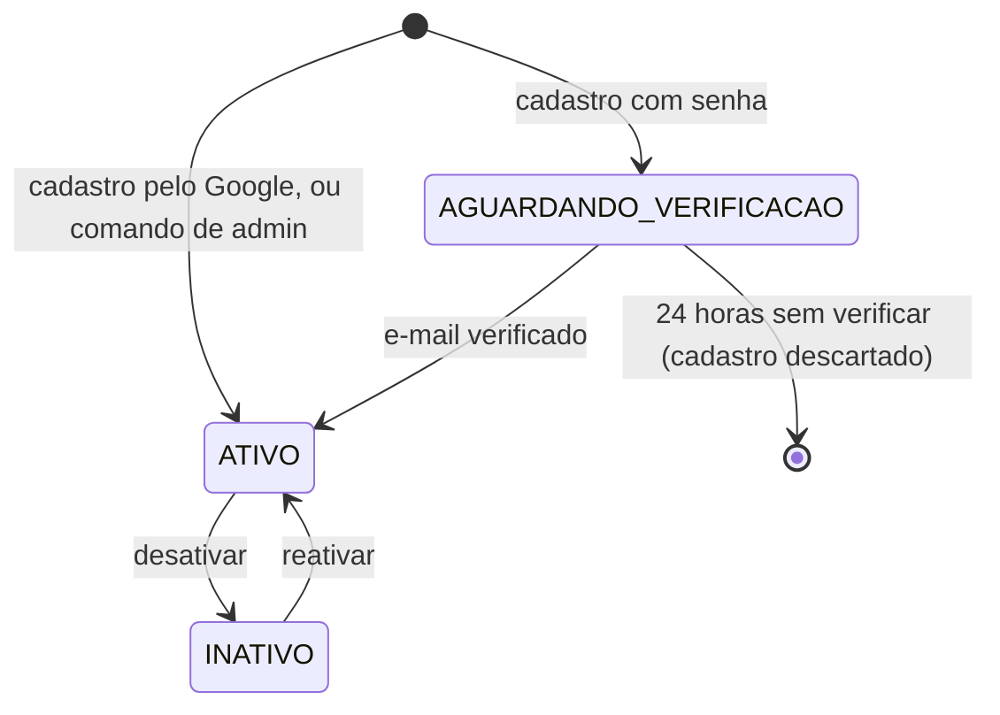
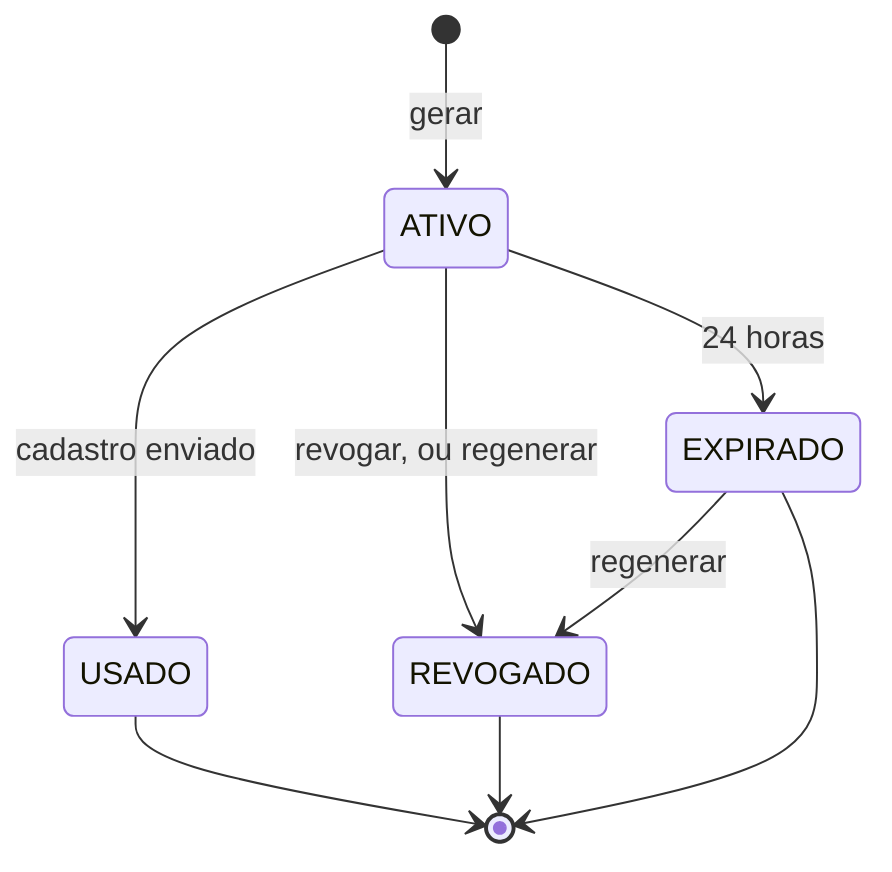

# Especificação Funcional: Identidade e acesso

| Campo | Valor |
| --- | --- |
| Feature | `acesso/identidade-e-acesso` |
| Status | Implemented |
| Responsável | Leandro Nascimento |
| Atualizado em | 2026-11-12 |
| Aprovado por | Leandro Nascimento |
| Aprovado em | 2026-11-12 |
| Requisitos | RF-001 a RF-014, RF-116, RF-117; RN-001 a RN-004, RN-024, RN-025; RNF-07 |
| Referências | Marco M2; canvas "Identidade e Permissões" em `docs/domain/strategic-design.md`; AD-006, AD-012, AD-015, AD-019; TD-001 |

## Problema e resultado esperado

O sistema nasce vazio e ninguém consegue entrar nele. Os diretores precisam de um jeito de entrar que seja
controlado pelo clube: só entra quem foi convidado, com e-mail comprovado, e o admin consegue tirar o acesso de quem
saiu sem apagar o histórico da pessoa.

Depois desta feature:

- quem tem acesso ao servidor cria o primeiro admin;
- o admin gera convites, e um convidado se cadastra, comprova o e-mail e entra, por senha ou pelo Google;
- o admin vê quem entrou, desativa e reativa usuários, e dá ou tira o papel de admin;
- todo diretor recém-cadastrado fica sem cargo, aguardando a classificação, que chega no M3.

## Atores e cenários

Atores: quem opera o servidor; admin; convidado (pessoa com um link de convite, ainda sem conta); diretor (usuário
com conta ativa).

### 1. Criar o primeiro admin

1. Quem opera o servidor roda o comando de criação de admin.
2. O comando pede nome, nome de usuário, e-mail, telefone e senha, digitados na hora.
3. O sistema cria o usuário como admin, ativo e com o e-mail já verificado.

O mesmo comando cria outro admin depois, se todos perderem o acesso. Ele recusa senha fraca e nome de usuário ou
e-mail já usados.

### 2. Gerar, regenerar e revogar um convite

1. O admin gera um convite.
2. O sistema mostra o link, que o admin copia e manda ao convidado por fora (por exemplo, WhatsApp).
3. O admin acompanha os convites numa lista, com a situação de cada um: ativo, usado, expirado ou revogado.

Alternativas:

- **Revogar:** o admin revoga um convite ativo; o link para de funcionar.
- **Regenerar:** o admin regenera um convite ativo ou expirado; o link antigo para de funcionar e nasce um novo, com
  24 horas.
- **Expirar:** 24 horas depois de gerado, o convite não usado passa a expirado.

### 3. Cadastrar-se pelo convite, com senha

1. O convidado abre o link.
2. O sistema mostra o formulário de cadastro e o aviso de privacidade.
3. O convidado informa nome, nome de usuário, telefone, e-mail e senha.
4. O sistema cria o cadastro como "aguardando verificação", marca o convite como usado e envia o link de verificação
   para o e-mail informado.
5. O convidado abre o link de verificação.
6. O sistema ativa a conta, como diretor sem cargo, e avisa os admins de que há um diretor para classificar.
7. O diretor entra no sistema.

Falhas e alternativas:

- **Convite inválido** (usado, expirado, revogado ou inexistente): o sistema mostra uma única mensagem, "convite
  inválido ou expirado", sem dizer qual é o caso, e não mostra o formulário.
- **Nome de usuário ou e-mail já em uso, ou senha fraca:** o sistema aponta o campo, e o convite continua válido.
- **Não recebeu o e-mail:** na tela de espera, o convidado pede o reenvio do link de verificação.
- **Não verificou em 24 horas:** o cadastro pendente é descartado, e o nome de usuário e o e-mail ficam livres de
  novo. O convite não volta: o admin gera outro.
- **Link de verificação inválido ou vencido:** o sistema avisa e oferece o reenvio.

### 4. Cadastrar-se pelo convite, com o Google

1. O convidado abre o link e escolhe "continuar com o Google".
2. O Google confirma a identidade e devolve o e-mail da conta.
3. O sistema pede o que falta: nome (já preenchido com o do Google), nome de usuário, telefone e senha.
4. O sistema cria a conta já ativa, como diretor sem cargo, sem link de verificação, marca o convite como usado e
   avisa os admins.

Falha: se o e-mail do Google já pertence a uma conta, o sistema não cria outra; mostra que a conta já existe e leva
ao login. O convite continua válido.

### 5. Entrar

- **Com senha:** o usuário informa o nome de usuário ou o e-mail, e a senha.
- **Com o Google:** o usuário escolhe "entrar com o Google"; se o e-mail do Google é o de uma conta ativa, ele entra,
  sem digitar senha.

Falhas:

- **Dados errados:** uma única mensagem, "usuário ou senha inválidos", sem dizer qual dos dois.
- **Muitas tentativas:** depois de 5 tentativas erradas em 15 minutos, o sistema pede para esperar antes de tentar de
  novo.
- **Conta aguardando verificação:** o sistema avisa que falta verificar o e-mail e oferece o reenvio.
- **Conta desativada:** o sistema recusa, com a mensagem de dados inválidos.
- **Google sem convite:** se o e-mail do Google não é de nenhuma conta, o sistema recusa e explica que o acesso é só
  por convite.

### 6. Sair

O usuário encerra a sessão. A sessão também acaba sozinha depois de 7 dias sem uso.

### 7. Recuperar a senha

1. O usuário informa o e-mail.
2. O sistema responde sempre a mesma coisa: "se houver uma conta com esse e-mail, enviamos as instruções".
3. Se a conta existe e está ativa, o sistema envia um link de uso único, válido por 1 hora.
4. O usuário abre o link e define a nova senha.
5. O sistema troca a senha e encerra todas as sessões abertas daquela conta.

### 8. Desativar e reativar um usuário

1. O admin abre a lista de usuários, com a situação de cada um (aguardando verificação, ativo, inativo), se é admin
   e se já tem cargo.
2. O admin desativa um usuário.
3. O sistema encerra na hora as sessões dele e passa a recusar o login.
4. O admin pode reativá-lo depois; o histórico continua o mesmo.

### 9. Dar e tirar o papel de admin

O admin torna admin um diretor ativo, ou tira o papel de outro admin. Ninguém tira o próprio papel.

### 10. Diretor sem cargo

Ao entrar, o diretor sem cargo vê uma página inicial que diz que o cadastro está concluído e aguarda a classificação
pelo admin. Ele não vê dados de gestão. O dashboard básico de verdade entra no M10; a classificação, no M3.

## Regras de negócio

| # | Regra | Requisito |
| --- | --- | --- |
| 1 | Só se cria conta por convite válido ou pelo comando de criação de admin | RN-001, RF-014 |
| 2 | O convite é de uso único, vale 24 horas, não carrega cargo, setor nem e-mail, e é marcado como usado no momento em que o cadastro é enviado | RF-001, RF-003, RF-004 |
| 3 | Na etapa 1, só o admin gera, regenera e revoga convites. A permissão de convidar, para outros usuários, chega com o catálogo de permissões (M3) | RF-001, RF-002 |
| 4 | O nome de usuário e o e-mail são únicos, sem diferenciar maiúsculas de minúsculas. O mesmo e-mail nunca resulta em duas contas | RN-002 |
| 5 | Nome de usuário: de 3 a 30 caracteres, só letras, números, ponto, hífen e sublinhado | RF-004 |
| 6 | Senha: no mínimo 10 caracteres, não pode ser só números, nem uma senha comum, nem parecida com o nome de usuário ou o e-mail | RNF-07 |
| 7 | Os dados do usuário são nome, nome de usuário, telefone, e-mail, senha e a situação. O sistema não pede CPF | RN-003, RF-004 |
| 8 | A conta com senha só fica ativa depois de o e-mail ser verificado. O link de verificação vale 24 horas e pode ser reenviado | RF-005 |
| 9 | O e-mail confirmado pelo Google dispensa o link de verificação | RF-008 |
| 10 | Senha e Google convivem na mesma conta: quem se cadastrou com senha pode entrar pelo Google com o mesmo e-mail, e quem se cadastrou pelo Google também tem senha | RF-006, RF-007 |
| 11 | Entrar pelo Google com o e-mail de uma conta que aguarda verificação conta como verificação | RF-005, RF-007 |
| 12 | Quem não tem conta não entra pelo Google | RF-009 |
| 13 | As respostas de login, de recuperação de senha e de convite inválido não revelam se uma conta, um e-mail ou um convite existe | RN-025 |
| 14 | Um usuário é desativado, nunca apagado. Desativar encerra as sessões na hora | RN-004, RF-012 |
| 15 | Só o admin desativa, reativa e dá ou tira o papel de admin | RN-005, RF-012, RF-116 |
| 16 | Ninguém desativa a si mesmo nem tira o próprio papel de admin. Assim sempre existe ao menos um admin ativo | RN-024 |
| 17 | Todo diretor recém-cadastrado fica sem cargo e sem acesso aos dados de gestão | RF-013, RF-024 |
| 18 | Trocar a senha pela recuperação encerra todas as sessões da conta | RF-010 |
| 19 | Convite gerado, regenerado, revogado e usado; cadastro concluído; admin criado pelo comando; ativação e desativação; papel de admin dado e tirado; e senha redefinida geram registro de auditoria. Senhas e links nunca entram no registro | RF-026 |
| 20 | O site e o aplicativo futuro usam o mesmo fluxo, pela mesma API | RNF-01 |

Situações de uma conta:

Situações de um convite:

## Fora de escopo

| Item | Onde está |
| --- | --- |
| Classificar o diretor (cargo e setores) e o catálogo de permissões | M3 (RF-015 a RF-023) |
| Permissão de convidar para quem não é admin | M3 |
| Consultar o histórico de auditoria nas telas | M3 (RF-027). Esta feature só grava os registros |
| Notificação registrada, com caixa de entrada, do cadastro concluído | M4. Aqui o aviso aos admins é um e-mail simples, mais a lista de usuários sem cargo |
| Perfil do usuário, e o usuário editar os próprios dados ou trocar a senha estando logado | M9 (pendência do enunciado). Até lá, a senha é trocada pela recuperação |
| Dashboard básico de verdade | M10 (RF-103) |
| Verificação em duas etapas | Não pedida; backlog |
| Cadastro aberto, torcedor e jogador | Etapas futuras |
| Aplicativo mobile | Etapa futura; a API já serve o fluxo |

## Critérios de aceite

Primeiro admin:

- [ ] CA-01 Dado um sistema vazio, quando o comando de criação de admin é executado com dados válidos, então existe
      um usuário admin, ativo e com e-mail verificado, que consegue entrar.
- [ ] CA-02 Dado o comando de criação de admin, quando a senha é fraca ou o nome de usuário ou o e-mail já existem,
      então nenhum usuário é criado e o motivo é mostrado.

Convite:

- [ ] CA-03 Dado um admin logado, quando ele gera um convite, então recebe um link que abre o formulário de cadastro.
- [ ] CA-04 Dado um usuário que não é admin, quando ele tenta gerar, regenerar, revogar ou listar convites, então o
      sistema nega.
- [ ] CA-05 Dado um convite gerado há mais de 24 horas e não usado, quando alguém abre o link, então vê "convite
      inválido ou expirado" e não vê o formulário.
- [ ] CA-06 Dado um convite revogado, usado ou inexistente, quando alguém abre o link, então vê a mesma mensagem do
      CA-05.
- [ ] CA-07 Dado um convite ativo ou expirado, quando o admin o regenera, então o link antigo deixa de funcionar e o
      novo vale por 24 horas.
- [ ] CA-08 Dado um admin, quando ele lista os convites, então vê cada um com a situação, quem gerou e quando.

Cadastro com senha:

- [ ] CA-09 Dado um convite ativo, quando o convidado envia o cadastro válido, então a conta fica aguardando
      verificação, o convite fica usado e um e-mail com o link de verificação é enviado ao endereço informado.
- [ ] CA-10 Dado um cadastro aguardando verificação, quando o dono tenta entrar, então o sistema recusa e oferece o
      reenvio do link.
- [ ] CA-11 Dado um cadastro aguardando verificação, quando o link de verificação é aberto dentro de 24 horas, então
      a conta fica ativa, sem cargo, e os admins recebem o aviso de diretor a classificar.
- [ ] CA-12 Dado um cadastro que não foi verificado em 24 horas, quando o prazo passa, então o cadastro é descartado
      e o mesmo nome de usuário e e-mail podem ser usados em outro convite.
- [ ] CA-13 Dado um convite ativo, quando o cadastro é enviado com nome de usuário ou e-mail já em uso (com qualquer
      combinação de maiúsculas), ou com senha fraca, então o campo é apontado, nenhuma conta é criada e o convite
      continua ativo.
- [ ] CA-14 Dado o formulário de cadastro, então ele não pede CPF e mostra o aviso de privacidade.

Cadastro e login com o Google:

- [ ] CA-15 Dado um convite ativo, quando o convidado se identifica pelo Google e completa nome de usuário, telefone
      e senha, então a conta fica ativa sem link de verificação, com o e-mail do Google, e o convite fica usado.
- [ ] CA-16 Dado um convite ativo, quando o e-mail do Google já é de uma conta, então nenhuma conta é criada e o
      convite continua ativo.
- [ ] CA-17 Dada uma conta ativa criada com senha, quando o dono entra pelo Google com o mesmo e-mail, então ele
      entra na mesma conta.
- [ ] CA-18 Dada uma conta criada pelo Google, quando o dono entra com nome de usuário e senha, então ele entra na
      mesma conta.
- [ ] CA-19 Dado alguém sem conta, quando tenta entrar pelo Google, então o sistema recusa e nenhuma conta é criada.

Login, saída e recuperação:

- [ ] CA-20 Dada uma conta ativa, quando o dono informa o nome de usuário ou o e-mail (com qualquer combinação de
      maiúsculas) e a senha certa, então ele entra.
- [ ] CA-21 Dado um login com usuário inexistente, e outro com senha errada, então as duas respostas são iguais.
- [ ] CA-22 Dadas 5 tentativas erradas em 15 minutos para a mesma conta, quando vem a sexta, então o sistema recusa
      e pede para esperar, mesmo com a senha certa.
- [ ] CA-23 Dado um usuário logado, quando ele sai, então a sessão deixa de valer.
- [ ] CA-24 Dado um pedido de recuperação, quando o e-mail existe e quando não existe, então as duas respostas são
      iguais; só no primeiro caso um e-mail é enviado.
- [ ] CA-25 Dado um link de recuperação, quando ele é usado dentro de 1 hora, então a senha muda, todas as sessões da
      conta acabam e o mesmo link não funciona de novo.
- [ ] CA-26 Dado um link de recuperação com mais de 1 hora, quando ele é aberto, então o sistema recusa.

Administração de usuários:

- [ ] CA-27 Dado um admin, quando ele lista os usuários, então vê cada um com a situação, se é admin e se tem cargo.
- [ ] CA-28 Dado um usuário ativo e logado, quando o admin o desativa, então a sessão dele deixa de valer na hora e
      ele não consegue mais entrar, nem por senha nem pelo Google.
- [ ] CA-29 Dado um usuário inativo, quando o admin o reativa, então ele volta a entrar, com o mesmo histórico.
- [ ] CA-30 Dado um admin, quando ele tenta desativar a si mesmo ou tirar o próprio papel de admin, então o sistema
      nega.
- [ ] CA-31 Dado um admin, quando ele torna admin um diretor ativo, então esse diretor passa a poder gerar convites.
- [ ] CA-32 Dado um usuário que não é admin, quando ele tenta listar usuários, desativar, reativar ou mexer no papel
      de admin, então o sistema nega.

Diretor sem cargo e transversais:

- [ ] CA-33 Dado um diretor recém-cadastrado, quando ele entra, então vê a página de "aguardando classificação" e
      não acessa nenhum dado de gestão.
- [ ] CA-34 Dada cada ação da regra 19, quando ela acontece, então existe um registro de auditoria com quem, o quê,
      quando e sobre qual item, sem senha nem link.
- [ ] CA-35 Dado qualquer fluxo desta spec, então ele funciona só pela API, sem depender de regra no site.
- [ ] CA-36 Dada uma requisição sem sessão válida a qualquer rota que não seja login, cadastro por convite,
      verificação, recuperação ou saúde, então o sistema nega.

## Decisões registradas nesta spec

| # | Decisão | Quem decidiu | Data |
| --- | --- | --- | --- |
| 1 | O login com senha aceita nome de usuário ou e-mail no mesmo campo | Leandro Nascimento | 2026-11-12 |
| 2 | O convite não fica preso a um e-mail; quem o abre primeiro se cadastra com o e-mail que quiser | Leandro Nascimento | 2026-11-12 |
| 3 | O primeiro admin é criado por um comando no servidor | Leandro Nascimento | 2026-11-12 |
| 4 | Pode haver vários admins; o sistema garante que sempre haja um | Leandro Nascimento | 2026-11-12 |

Propostas do agente, aprovadas pelo dono junto com esta spec, em 2026-11-12:

| # | Proposta | Motivo |
| --- | --- | --- |
| P1 | O convite é marcado como usado quando o cadastro é enviado, e não quando o e-mail é verificado | Impede duas pessoas de usarem o mesmo link ao mesmo tempo |
| P2 | Cadastro não verificado em 24 horas é descartado, e o convite não volta | Um erro de digitação no e-mail não prende o nome de usuário para sempre; o admin gera outro convite |
| P3 | Senha de no mínimo 10 caracteres, com as validações da regra 6 | Recomendação corrente: comprimento vale mais que exigir símbolos |
| P4 | 5 tentativas erradas em 15 minutos bloqueiam temporariamente o login da conta | Barra adivinhação de senha sem travar a conta para sempre |
| P5 | Link de recuperação de senha com 1 hora; link de verificação com 24 horas | O de senha dá acesso à conta, então dura menos |
| P6 | Sessão acaba depois de 7 dias sem uso | Equilíbrio entre comodidade e risco, num sistema financeiro |
| P7 | Ninguém desativa a si mesmo nem tira o próprio papel de admin (regra 16) | Garante ao menos um admin sem precisar contar admins |
| P8 | Entrar pelo Google com o e-mail de uma conta que aguarda verificação a ativa (regra 11) | O Google já comprovou o e-mail |
| P9 | O aviso aos admins, neste marco, é um e-mail simples e a lista de usuários sem cargo; a notificação registrada vem no M4 | O módulo de notificações ainda não existe |
| P10 | A gravação dos registros de auditoria é antecipada do M3 para este marco; a consulta nas telas continua no M3 | Convite, ativação e papel de admin são ações que o enunciado manda auditar (AUD-02), e elas nascem aqui |
| P11 | O formulário de cadastro mostra um aviso de privacidade; o texto é definido na technical-spec, com a avaliação de LGPD (AD-015) | O sistema passa a guardar dados pessoais |
| P12 | O diretor não troca a própria senha estando logado neste marco; usa a recuperação | A edição dos próprios dados é pendência do M9 |

## Adendos

Nenhum.
