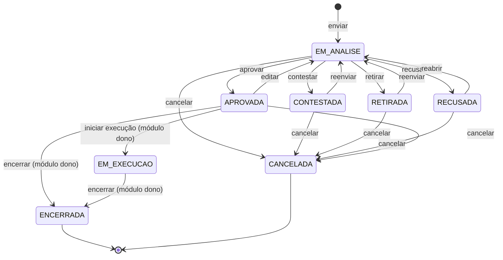

# Especificação Funcional: Motor de solicitações e aprovações

| Campo | Valor |
| --- | --- |
| Feature | `aprovacoes/motor-de-solicitacoes` |
| Status | Approved |
| Responsável | Leandro Nascimento |
| Atualizado em | 2026-11-13 |
| Aprovado por | Leandro Nascimento |
| Aprovado em | 2026-11-13 |
| Requisitos | RF-033 a RF-045, RF-120 a RF-122; RN-010 a RN-013; INV-SOL-01 a INV-SOL-11 |
| Referências | Marco M5; canvas `docs/domain/aggregates/solicitacao.md`; `docs/domain/domain-events.md`; AD-008; hotspots H12, H16, H19, H21, H26; features `permissoes/catalogo-e-classificacao` e `notificacoes/caixa-e-email` |

## Problema e resultado esperado

Gastos e eventos do clube precisam de uma decisão formal antes de produzir efeito: alguém pede, outra pessoa decide,
com motivo, e fica registrado o que exatamente foi aprovado. O mesmo ciclo vale para um gasto, para o orçamento de um
evento e para o próprio evento.

Esta feature entrega esse ciclo uma vez só, como um motor que não sabe do que o pedido trata. Depois dela:

- um módulo registra um tipo de solicitação (gasto no M7, evento no M8) e passa a usar o ciclo inteiro;
- o solicitante envia, retira para corrigir, reenvia, reabre, edita e cancela;
- o aprovador aprova, contesta ou recusa, sempre com um motivo;
- cada mudança no pedido vira uma versão, e nenhuma versão ou decisão se perde;
- ninguém decide o próprio pedido sem a permissão de auto-aprovação.

Nesta feature não existe nenhum tipo de solicitação de verdade: o motor é exercitado com um tipo de teste, e as
telas ficam prontas para os tipos que os próximos marcos registrarem.

## Atores e cenários

Atores: solicitante; aprovador (quem tem a permissão de aprovar aquele tipo, ou o diretor indicado para aquele
pedido); admin; qualquer diretor com cargo, que lê; o módulo dono do tipo (Financeiro, Eventos).

### 1. Enviar e aprovar (caminho feliz)

1. O solicitante envia uma solicitação de um tipo registrado, com o conteúdo que o tipo pede.
2. O sistema cria a versão 1, põe a solicitação em análise e notifica quem pode decidir.
3. Um aprovador abre a solicitação pela fila de pendências e a aprova, escolhendo um motivo e, se quiser, escrevendo
   um texto.
4. O sistema registra a decisão, avisa o módulo dono do tipo e notifica o solicitante.

### 2. Contestar e reenviar

1. O aprovador contesta a solicitação: escolhe um motivo, escreve uma mensagem e, se a solicitação tem valor, pode
   sugerir um teto.
2. O sistema notifica o solicitante, com um texto padrão, a mensagem do aprovador e o teto sugerido.
3. O solicitante corrige o conteúdo e reenvia. O sistema cria a versão seguinte e a solicitação volta à análise.

Não há limite de rodadas.

### 3. Recusar e reabrir

1. O aprovador recusa, com motivo.
2. O solicitante (ou o admin, ou quem tem a permissão de reabrir) reabre a solicitação, com uma justificativa e, se
   quiser, o conteúdo alterado. Nasce uma versão nova, que volta à análise.

Não há limite de reaberturas.

### 4. Retirar para corrigir

1. Com a solicitação ainda em análise, o solicitante percebe um erro e a retira.
2. A solicitação sai da fila dos aprovadores e fica com o solicitante.
3. Ele corrige e reenvia; nasce a versão seguinte, em análise.

### 5. Editar uma solicitação aprovada

1. O solicitante edita uma solicitação aprovada cuja execução ainda não começou.
2. Nasce uma versão nova, em análise. A aprovação anterior não vale para ela.
3. O módulo dono é avisado de que a solicitação deixou de estar aprovada.

Depois que a execução começa (por exemplo, o recurso foi enviado), a solicitação não pode mais ser editada.

### 6. Cancelar

O solicitante, o admin ou quem tem a permissão de cancelar cancela a solicitação, com motivo, enquanto a execução não
começou. Cancelada, ela não aceita mais nada e continua no histórico.

### 7. Quando o solicitante é quem decidiria

- **Sem auto-aprovação:** se o solicitante tem a permissão de aprovar aquele tipo, ele precisa indicar outro diretor
  como aprovador daquele pedido ao enviar. A indicação fica no histórico, e o admin é notificado. O indicado decide
  só aquele pedido; os outros que têm a permissão, e o admin, continuam podendo decidir.
- **Com auto-aprovação:** a solicitação entra em análise como qualquer outra e ele mesmo pode decidir, com motivo. A
  decisão fica marcada como "aprovação própria" no histórico, e o admin é notificado.

### 8. Solicitação parada

- Depois de 3 dias em análise sem decisão, quem pode decidir recebe um lembrete.
- Depois de 7 dias, o admin também é avisado.

Cada aviso acontece uma vez por versão.

### 9. Consultar

- **Fila de pendências:** o aprovador vê as solicitações em análise que ele pode decidir, da mais antiga para a mais
  nova.
- **Lista:** qualquer diretor com cargo vê as solicitações, com filtro por tipo, por situação e "as minhas".
- **Detalhe:** todas as versões, com o conteúdo de cada uma; todas as decisões, com aprovador, motivo, texto,
  mensagem e teto; a indicação de aprovador; e o histórico.

### 10. Manter os motivos de decisão

O admin cadastra, edita o texto e desativa motivos, separados por tipo de decisão (aprovar, contestar, recusar; os
próximos marcos acrescentam os seus, como validar um pagamento). O sistema nasce com uma lista sugerida. Um motivo
desativado some das opções e continua aparecendo nas decisões antigas.

## Regras de negócio

As invariantes do aggregate estão em `docs/domain/aggregates/solicitacao.md`. Esta spec as mantém e acrescenta o que
segue.

| # | Regra | Requisito |
| --- | --- | --- |
| 1 | Só se decide uma solicitação em análise, e a decisão vale para a versão vigente | INV-SOL-01 |
| 2 | O solicitante não decide o próprio pedido, salvo com a permissão de auto-aprovação; nesse caso a decisão fica marcada como aprovação própria e o admin é notificado | INV-SOL-02, RN-012 |
| 3 | Cada versão tem no máximo uma decisão, de um aprovador só | INV-SOL-03, RN-010 |
| 4 | Toda decisão tem um motivo da lista, com texto opcional; contestar exige também uma mensagem | INV-SOL-04, RN-011 |
| 5 | Nenhuma versão é alterada; reenviar, reabrir e editar criam a versão seguinte, e as decisões antigas não valem para ela | INV-SOL-05, INV-SOL-06 |
| 6 | Teto sugerido só existe em contestação de solicitação com valor | INV-SOL-07 |
| 7 | Encerrada e cancelada não aceitam mais nada | INV-SOL-08 |
| 8 | Em execução, a solicitação não pode ser editada, retirada nem cancelada; a correção é por complemento ou devolução, no módulo dono | INV-SOL-09 |
| 9 | Quem pode aprovar o tipo e não tem auto-aprovação só envia com um aprovador indicado, que não pode ser ele mesmo e precisa ser um diretor ativo com cargo | INV-SOL-10; proposta P2 |
| 10 | O aprovador indicado decide só aquela solicitação; a indicação vale para todas as versões dela | INV-SOL-11 |
| 11 | Só o solicitante retira, reenvia e edita; reabrir e cancelar também podem o admin e quem tem a permissão | RF-040, RF-042 |
| 12 | Retirar só é possível em análise; a solicitação retirada sai da fila e só volta por reenvio | RF-120 |
| 13 | Quem pode decidir um tipo é quem tem a permissão de aprovar daquele tipo; o admin sempre pode | RN-010 |
| 14 | Cada tipo de solicitação declara a própria permissão de aprovar e se tem valor | AD-008 |
| 15 | O conteúdo de cada versão é definido e validado pelo módulo dono do tipo; o motor o guarda como veio e não o interpreta, a não ser o valor | AD-008 |
| 16 | O módulo dono é avisado, na mesma transação, de cada mudança de situação: aprovada, contestada, recusada, editada, reaberta, retirada e cancelada | ADR-003 |
| 17 | Só o módulo dono põe a solicitação em execução e a encerra | Canvas |
| 18 | Todo diretor com cargo lê qualquer solicitação; diretor sem cargo não lê nenhuma | RF-025 |
| 19 | Só o admin mantém os motivos de decisão; motivo usado nunca é apagado | RN-005, RN-014 |
| 20 | A decisão guarda o texto do motivo como estava no momento; mudar o motivo depois não muda decisões antigas | Princípio de fronteira 4 |
| 21 | Toda ação sobre a solicitação e sobre os motivos gera registro de auditoria | RF-026 |

Situações:

`RETIRADA` é uma situação nova em relação ao canvas aprovado; o canvas ganha um adendo com a aprovação desta spec.

Permissões que esta feature acrescenta ao catálogo:

| Permissão | O que permite | Sugerida de início a |
| --- | --- | --- |
| Auto-aprovar | Decidir a própria solicitação. Fica fora do acesso total | Ninguém |
| Reabrir solicitações | Reabrir solicitação recusada de outra pessoa | Ninguém |
| Cancelar solicitações | Cancelar solicitação de outra pessoa | Ninguém |

A permissão de aprovar cada tipo é declarada pelo módulo dono, no marco dele.

Notificações que esta feature gera:

| Quando | Quem é avisado | Pede ação? |
| --- | --- | --- |
| Solicitação enviada, reenviada, reaberta ou editada | Quem pode decidir (menos o solicitante sem auto-aprovação) | Sim |
| Solicitação aprovada ou recusada | O solicitante | Não |
| Solicitação contestada | O solicitante | Sim |
| Aprovador indicado | O indicado (pede ação) e o admin (informativa) | — |
| Aprovação própria | O admin | Não |
| 3 dias em análise | Quem pode decidir | Sim |
| 7 dias em análise | O admin | Não |
| Solicitação cancelada ou retirada | Quem podia decidir | Não |

## Fora de escopo

| Item | Onde está |
| --- | --- |
| Solicitação de gasto, saída, envio do recurso e prestação de contas | M7 |
| Evento e solicitação orçamentária, e o vínculo entre as duas | M8 |
| Uma solicitação decidida por dois ou mais aprovadores | Backlog (decisão do dono na descoberta, H16) |
| Prazos de lembrete configuráveis pelo admin | Backlog; nesta feature são fixos (3 e 7 dias) |
| Trocar o aprovador indicado depois do envio | Backlog; o admin e os demais aprovadores continuam podendo decidir |
| Motivos de validação de pagamento e de decisões financeiras | M6, que acrescenta os tipos de decisão dele |
| Anexos na solicitação | M7, com o armazenamento de anexos (AD-011) |

## Critérios de aceite

Ciclo básico:

- [ ] CA-01 Dado um tipo registrado, quando o solicitante envia uma solicitação válida, então ela fica em análise,
      com a versão 1, e quem pode decidir é notificado.
- [ ] CA-02 Dado um tipo que não existe, ou um conteúdo que o módulo dono recusa, então nada é criado.
- [ ] CA-03 Dada uma solicitação em análise, quando um aprovador a aprova com motivo, então ela fica aprovada, a
      decisão guarda aprovador, motivo, texto e momento, o módulo dono é avisado e o solicitante é notificado.
- [ ] CA-04 Dada uma decisão sem motivo, ou com motivo desativado ou de outro tipo de decisão, então o sistema
      recusa.
- [ ] CA-05 Dada uma solicitação que não está em análise, quando alguém tenta decidi-la, então o sistema recusa.
- [ ] CA-06 Dadas duas decisões simultâneas sobre a mesma versão, então só uma vale e a outra é recusada.

Contestar, recusar, reabrir, retirar:

- [ ] CA-07 Dada uma solicitação em análise, quando o aprovador a contesta com motivo e mensagem, então ela fica
      contestada e o solicitante recebe o texto padrão, a mensagem e, se houver, o teto sugerido.
- [ ] CA-08 Dada uma contestação sem mensagem, ou com teto numa solicitação sem valor, então o sistema recusa.
- [ ] CA-09 Dada uma solicitação contestada, quando o solicitante reenvia com o conteúdo corrigido, então nasce a
      versão seguinte, em análise, e a versão anterior e a decisão dela continuam visíveis.
- [ ] CA-10 Dada uma solicitação recusada, quando o solicitante a reabre com justificativa, então nasce uma versão
      nova, em análise; sem justificativa, o sistema recusa. O mesmo vale por várias rodadas.
- [ ] CA-11 Dada uma solicitação recusada de outra pessoa, então só o admin ou quem tem a permissão de reabrir
      consegue reabri-la.
- [ ] CA-12 Dada uma solicitação em análise, quando o solicitante a retira, então ela sai da fila dos aprovadores,
      não pode ser decidida, e o solicitante pode reenviá-la como nova versão.
- [ ] CA-13 Dada uma solicitação em análise de outra pessoa, então ninguém além do solicitante consegue retirá-la.

Editar, cancelar, execução:

- [ ] CA-14 Dada uma solicitação aprovada, quando o solicitante a edita, então nasce uma versão nova em análise, a
      aprovação anterior não vale para ela, e o módulo dono é avisado.
- [ ] CA-15 Dada uma solicitação em execução, quando alguém tenta editá-la, retirá-la ou cancelá-la, então o sistema
      recusa.
- [ ] CA-16 Dada uma solicitação que não está em execução nem encerrada, quando o solicitante a cancela com motivo,
      então ela fica cancelada e não aceita mais nenhuma ação; sem motivo, o sistema recusa.
- [ ] CA-17 Dada uma solicitação de outra pessoa, então só o admin ou quem tem a permissão de cancelar a cancela.
- [ ] CA-18 Dado um usuário comum, quando ele tenta pôr uma solicitação em execução ou encerrá-la pela API, então
      não existe rota para isso: só o módulo dono o faz.

Quem decide:

- [ ] CA-19 Dado um solicitante sem a permissão de aprovar o tipo, então ele não consegue decidir o próprio pedido
      nem o de outro.
- [ ] CA-20 Dado um solicitante com a permissão de aprovar o tipo e sem auto-aprovação, quando ele envia sem indicar
      aprovador, ou indicando a si mesmo, um inativo ou um diretor sem cargo, então o sistema recusa.
- [ ] CA-21 Dada a indicação válida, então o indicado consegue decidir aquela solicitação e nenhuma outra; a
      indicação aparece no histórico; e o admin é notificado.
- [ ] CA-22 Dado um solicitante com a permissão de aprovar e sem auto-aprovação, quando ele tenta decidir o próprio
      pedido, então o sistema recusa, mesmo com aprovador indicado.
- [ ] CA-23 Dado um solicitante com auto-aprovação, quando ele decide o próprio pedido, então a decisão vale, fica
      marcada como aprovação própria, e o admin é notificado.
- [ ] CA-24 Dado um usuário com acesso total e sem a permissão de auto-aprovar, então ele não decide o próprio
      pedido.
- [ ] CA-25 Dado o admin, então ele decide qualquer solicitação, inclusive a própria, com a marca de aprovação
      própria.

Consulta:

- [ ] CA-26 Dado um aprovador, quando ele abre a fila de pendências, então vê só as solicitações em análise que pode
      decidir, da mais antiga para a mais nova, sem as próprias (salvo com auto-aprovação).
- [ ] CA-27 Dado um diretor com cargo, quando ele lista as solicitações, então vê todas, e os filtros por tipo, por
      situação e "as minhas" funcionam; um diretor sem cargo é negado.
- [ ] CA-28 Dado o detalhe de uma solicitação, então ele mostra todas as versões com o conteúdo de cada uma, todas
      as decisões com aprovador, motivo, texto, mensagem e teto, a indicação de aprovador e o histórico.

Motivos, lembretes e auditoria:

- [ ] CA-29 Dado um sistema recém-instalado, então existem motivos sugeridos para aprovar, contestar e recusar.
- [ ] CA-30 Dado o admin, quando ele cria, edita ou desativa um motivo, então a lista de opções muda, e as decisões
      antigas continuam mostrando o texto que tinham.
- [ ] CA-31 Dado um usuário que não é admin, quando ele tenta alterar motivos, então o sistema nega.
- [ ] CA-32 Dada uma solicitação há 3 dias em análise, então quem pode decidir recebe um lembrete; aos 7 dias, o
      admin é avisado; rodar a tarefa de novo não repete nenhum dos dois para a mesma versão.
- [ ] CA-33 Dada cada ação desta spec sobre uma solicitação ou um motivo, então existe um registro de auditoria.
- [ ] CA-34 Dado o motor com dois tipos registrados por módulos diferentes, então cada módulo recebe só os avisos do
      próprio tipo, e o motor não importa nenhum dos dois.

## Decisões registradas nesta spec

| # | Decisão | Quem decidiu | Data |
| --- | --- | --- | --- |
| 1 | O sistema nasce com uma lista sugerida de motivos de decisão | Leandro Nascimento | 2026-11-13 |
| 2 | Em análise, o solicitante pode retirar a solicitação para corrigir e reenviar | Leandro Nascimento | 2026-11-13 |
| 3 | Solicitação parada gera lembrete aos 3 dias e aviso ao admin aos 7 | Leandro Nascimento | 2026-11-13 |
| 4 | Quem tem auto-aprovação decide o próprio pedido pelo caminho normal, com a marca de aprovação própria e aviso ao admin | Leandro Nascimento | 2026-11-13 |

Propostas do agente, aprovadas pelo dono junto com esta spec, em 2026-11-13:

| # | Proposta | Motivo |
| --- | --- | --- |
| P1 | Situação nova `RETIRADA`, com adendo no canvas do aggregate | A decisão 2 precisa de um lugar para a solicitação ficar enquanto é corrigida, fora da fila |
| P2 | O aprovador indicado precisa ser um diretor ativo com cargo (regra 9) | "Qualquer diretor" foi a sua resposta; restrinjo só a quem já pode ler o pedido |
| P3 | Com aprovador indicado, os demais aprovadores e o admin continuam podendo decidir (regra 10) | Evita o pedido ficar preso se o indicado sumir; a troca de indicado fica no backlog |
| P4 | A indicação vale para todas as versões da mesma solicitação | Reenviar não deveria exigir indicar de novo |
| P5 | Três permissões novas: auto-aprovar, reabrir e cancelar solicitações de outros (tabela acima) | O enunciado já as cita (APR-02, APR-06, APR-10) |
| P6 | Todo diretor com cargo lê todas as solicitações (regra 18) | É a regra de leitura do enunciado (PER-01) |
| P7 | Lembretes com prazos fixos nesta feature (3 e 7 dias) | Configurar prazo é tela e regra a mais, sem pedido concreto |
| P8 | As telas (fila, lista, detalhe e motivos) ficam prontas neste marco, mesmo sem nenhum tipo real | O M7 e o M8 só acrescentam o formulário e o conteúdo do próprio tipo |
| P9 | Quando a solicitação é retirada ou cancelada, quem podia decidir é avisado | Para não procurarem na fila um pedido que saiu dela |

## Adendos

Nenhum.
