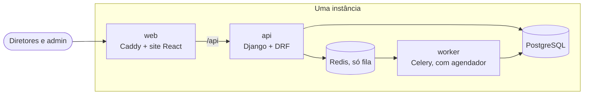

# Constituição do projeto

Princípios, arquitetura em alto nível, Definition of Done e convenções de Git. Os demais documentos desta pasta
detalham o que é pedido ([01-spec](01-spec.md)), como será feito ([02-plan](02-plan.md)), em que ordem
([03-tasks](03-tasks.md)) e como o risco foi tratado ([04-seguranca](04-seguranca.md)).

## 1. Propósito e restrições

O Club Manager é um sistema de governança financeira e institucional de um time de futebol, usado pelos diretores:
entradas e saídas escriturais, aprovação formal de gastos e eventos, e rastreabilidade de quem fez o quê e quando.

Restrições que não mudam sem decisão registrada no [plano](02-plan.md):

- custo mínimo: uma única instância AWS, só os ambientes local e produção;
- uma API única serve o site e, depois, o aplicativo; regras de negócio, permissões e auditoria ficam sempre nela;
- os valores são escriturais: o sistema registra e o dinheiro se move por fora, na conta do clube;
- nada é apagado: desativa-se, cancela-se ou estorna-se;
- o sistema não coleta CPF.

Etapas futuras (aplicativo, torcedor e jogador, gestão do time, multi-cliente) não são implementadas, mas nada pode
impedi-las.

## 2. Princípios

1. **A spec é a fonte da verdade.** Se código e spec divergirem, para-se e reporta-se; não se corrige em silêncio.
2. **Teste primeiro.** Os testes são o critério de aceite: escrevem-se antes e veem-se falhar pelo motivo certo.
   Nunca se altera teste, configuração de teste ou spec só para algo passar.
3. **Regra de negócio só na API.** O site chama e mostra.
4. **Auditoria na mesma transação** do caso de uso, para toda ação relevante.
5. **Estado muda por intenção.** Funções ou métodos que revelam o que fazem, e não atualizações de campo espalhadas.
6. **Registros liquidados são imutáveis.** Estorno e cancelamento são lançamentos novos ligados ao original.
7. **Dinheiro em tipo decimal**, nunca ponto flutuante.
8. **Toda rota é negada por padrão.** A que for aberta declara a permissão; toda rota de escrita declara quem
   pode (permissão do catálogo, admin, ou condição definida na spec) e a conferência é feita na rota e no serviço.
9. **Sem abstração especulativa.** Só se cria estrutura quando há um sinal concreto que a justifique.
10. **Aprovação é humana.** Uma spec só passa a aprovada por decisão explícita do dono do projeto, registrada com
    papel e data. Mudança material numa spec aprovada a devolve a rascunho.

## 3. Arquitetura em alto nível

Monólito modular, com DDD tático nos módulos core (`aprovacoes`, `financeiro`, `eventos`) e camadas (API →
serviços → modelos) nos demais.



Regras de dependência:

- Um módulo de topo por área de negócio. De outro módulo, importa-se só `<modulo>.public`, nunca modelos ou serviços
  internos. A verificação de fronteira roda no CI.
- As dependências entre módulos são acíclicas; `aprovacoes` não conhece `financeiro` nem `eventos`: quem usa o
  motor se registra nele como tipo de solicitação.
- Para um contexto de cima: chamada direta à API pública. Para um de baixo: evento de integração em processo,
  síncrono e na mesma transação. E-mail e trabalho pesado são enfileirados depois do commit.
- A camada de API só valida a entrada, chama um serviço e formata a saída. Os serviços abrem a transação, checam a
  permissão e registram a auditoria. As funções de decisão são puras e não importam o framework.
- Nos módulos core, o aggregate é o modelo persistido, e o estado só muda pelos métodos dele.
- Tarefas agendadas são idempotentes e só chamam um serviço do módulo dono.
- Ports só nas fronteiras reais: e-mail, armazenamento de anexos, identidade Google e canais de notificação.

| Contexto | Tipo | Módulos | Pode importar a API pública de |
| --- | --- | --- | --- |
| Auditoria | Generic | `auditoria` | — |
| Identidade e Permissões | Supporting | `acesso`, `permissoes` | `auditoria` |
| Notificações | Generic | `notificacoes` | `permissoes`, `acesso`, `auditoria` |
| Marca | Generic | `marca` | `permissoes`, `auditoria` |
| Aprovações | Core | `aprovacoes` | `notificacoes`, `permissoes`, `acesso`, `auditoria` |
| Financeiro | Core | `financeiro` | `aprovacoes` e os de cima |
| Eventos | Core | `eventos` | `financeiro`, `aprovacoes` e os de cima |
| Comunicação | Supporting | `comunicacao` | `permissoes`, `notificacoes`, `auditoria` |
| Relatórios | Supporting | `relatorios` | todos, só para leitura |

**Decidido contra** (adicionar qualquer um exige nova decisão no plano): port ou repository para o banco; entidade
de domínio separada do modelo de persistência; interactors, presenters ou DTOs de boundary; container de injeção
de dependência; aggregates, value objects ou eventos de domínio fora dos três módulos core; mensageria entre
módulos, barramento de eventos ou outbox; event sourcing ou CQRS com read models; um segundo serviço de backend;
coluna de cliente (tenant) ou schema por cliente; port de pagamento.

## 4. Linguagem do domínio

- Só solicitações são aprovadas, só pagamentos são validados, só saídas são liquidadas, só eventos são realizados.
- O devedor questiona uma cobrança; o aprovador contesta uma solicitação.
- O termo é **permissão**, nunca regra, role ou privilégio.
- Nomes no código: domínio na língua do negócio, em português sem acento (`Cobranca`, `Solicitacao`, `Isencao`);
  infraestrutura em inglês (`repository`, `settings`, `tasks`).

## 5. Qualidade

- Funções pequenas e coesas, nomes explícitos, validação cedo em vez de condicionais aninhados.
- Comentários explicam decisões não óbvias, não o que o código diz.
- Linhas de até 110 colunas, inclusive em comentários, docstrings e textos longos.
- Backend: Ruff (formato e lint, com as regras de segurança `S`), mypy em modo estrito. Site: oxlint e `tsc`.
- Cobertura mínima de 80%, sem reduzir a do código alterado.
- Fakes só em fronteiras reais; banco real nos testes de integração; sem rede real em testes unitários.
- Os fluxos críticos (aprovação, validação, permissões, recorrência) têm cobertura reforçada, porque não há ambiente
  de homologação.
- Dados: migrações versionadas e reversíveis são o único mecanismo de schema; a produção nunca deixa o ORM criar ou
  atualizar o schema; backup do banco antes de qualquer mudança com dados em produção; seeds de demonstração só
  atrás de uma flag de desenvolvimento; nenhum usuário ou senha padrão.
- Erros para o cliente usam envelope e código estáveis; nunca stack trace, SQL ou mensagem interna.
- Logs estruturados, com ID de correlação e sem dados pessoais, tokens ou segredos.
- Segredos só por variável de ambiente; `.env` nunca vai para o git. Acesso a anexos sempre controlado por permissão.

## 6. Fluxo de trabalho

Toda feature não trivial passa por: functional-spec → aprovação → technical-spec → aprovação → plano de
implementação → implementação com evidência. Um marco por vez, na ordem de [03-tasks](03-tasks.md). As pendências do
enunciado são decididas no refinamento do marco, perguntando ao dono quando não houver hipótese razoável.

Em cada tarefa: teste falhando → código mínimo → refatoração → verificação completa verde → commit. Um ciclo verde
é um commit.

## 7. Definition of Ready

Uma feature só começa quando:

- [ ] a regra de negócio está mapeada no domínio (aggregate, invariantes e eventos nos contextos core; regras de
      negócio nos de apoio);
- [ ] os requisitos estão na [spec](01-spec.md) com status `Aprovado`;
- [ ] os critérios de aceite estão escritos e são verificáveis;
- [ ] as dependências com outros marcos estão identificadas e os contratos consumidos já existem;
- [ ] as pendências do marco foram decididas pelo dono ou postas explicitamente fora do escopo;
- [ ] o contrato de entrada e saída está definido, ao menos no nível conceitual;
- [ ] não há decisão em aberto no [plano](02-plan.md) que bloqueie o trabalho;
- [ ] a functional-spec e a technical-spec foram aprovadas pelo dono.

## 8. Definition of Done

Uma feature só termina quando:

- [ ] a regra de negócio está no aggregate, nas funções de decisão ou no serviço; não vazou para a API nem para o site;
- [ ] toda invariante tocada tem teste; o fluxo do caso de uso tem teste de integração com o banco real;
- [ ] toda ação relevante gera registro de auditoria, e isso está testado;
- [ ] a verificação completa passa (`uv run poe verify` em `backend/` e `npm run verify` em `frontend/`) e a cobertura
      de 80% foi respeitada;
- [ ] o teste de fronteira de módulos continua verde;
- [ ] a revisão de segurança foi registrada em [04-seguranca](04-seguranca.md), sem achado crítico ou alto em aberto;
- [ ] o contrato da API e a documentação foram atualizados, se o contrato mudou;
- [ ] os eventos de integração previstos são publicados e tratados corretamente;
- [ ] a checklist de auto-revisão do modelo de PR foi conferida;
- [ ] os critérios de aceite foram validados, por teste automatizado ou manualmente com evidência, e o dono aprovou;
- [ ] a spec (status e feature), os riscos, as decisões e a matriz requisito → teste refletem o que foi feito.

**Fim de marco**, além do Done de cada feature:

- [ ] o critério de aceite do marco foi demonstrado;
- [ ] o relatório de segurança do marco foi escrito;
- [ ] a auditoria de coerência entre documentos e código foi feita e as divergências foram resolvidas ou registradas;
- [ ] o dono aprovou o marco, com data, em [03-tasks](03-tasks.md);
- [ ] o sistema foi subido de verdade (contêineres) e percorrido, porque o CI não sobe os contêineres;
- [ ] o marco está integrado na `dev`; a `main` e a tag só entram na entrega final da etapa (ver Git).

## 9. Convenções de Git

**Branches** — modelo `main` + `dev`:

- `main`: recebe um único merge, o final, quando a etapa 1 estiver pronta e com autorização explícita do dono;
  é dela que sai o deploy de produção. Nunca por marco, e nunca push ou merge sem autorização.
- `dev`: branch de integração; toda feature nasce dela e volta para ela depois do checkpoint.
- Nome: `<tipo>/<escopo>-<descricao-curta>`, tudo minúsculo. Ex.: `feat/financeiro-validacao-de-pagamento`.

**Commits** — [Conventional Commits](https://www.conventionalcommits.org/pt-br/v1.0.0/):

```text
<tipo>(<escopo>): <assunto>

<corpo opcional: o quê e por quê, não como>

Refs: RF-NN
```

| Parâmetro | Regra |
| --- | --- |
| Tipos | `feat`, `fix`, `refactor`, `perf`, `test`, `docs`, `build`, `ci`, `chore`, `style`, `revert` |
| Escopos | `acesso`, `permissoes`, `auditoria`, `notificacoes`, `aprovacoes`, `financeiro`, `eventos`, `comunicacao`, `marca`, `relatorios`, `web`, `metodo`, `platform`, `deps`, `readme` — obrigatório |
| Assunto | Português, imperativo, minúsculo, sem ponto final, até 72 caracteres |
| Corpo | Quebra em 72–100 colunas; explica o porquê |
| Rodapé | `Refs: RF-NN`, `RNF-NN` ou `RN-NN` quando houver requisito; `BREAKING CHANGE: …` quando quebrar contrato |

`web` cobre o site e `platform` cobre Docker, CI, configuração e deploy.

**Pull requests** — o título segue o formato de commit; a checklist de `.github/pull_request_template.md` é
conferida antes de cada merge na `dev` e na `main`. Merge por merge commit, para preservar um commit por ciclo verde;
a branch é apagada depois.

**Revisão** — o revisor sênior entra só em mudança brusca (contrato, arquitetura ou rumo) e no PR final da
entrega. A cada PR avalia-se se ele merece uma revisão mais cuidadosa, e a decisão é do dono.

**Documentação** — `docs/sdd/` e o README são a versão definitiva e acompanham o código: mudou o comportamento,
muda primeiro a spec, depois o teste, depois o código; mudou a arquitetura, o ciclo de vida ou o modelo de dados,
atualizam-se também o README e os diagramas. Nenhum nome de pessoa (usam-se papéis), dado pessoal real, segredo,
nem registro de processo entra no repositório.

**Versões** — tag SemVer na `main`, só para mudança de versão do sistema pronto. A etapa 1 inteira é a `v1.0.0`: os
marcos são integrados na `dev`, sem tag e sem merge na `main`. As tags `v0.1.0` (M1) e `v0.2.0` (M2) já existiam
e ficam como estão.

**Nunca**: commitar segredos, `.env`, credenciais ou dados pessoais reais; alterar testes ou a spec só para o build
passar; fazer push ou merge na `main` sem autorização.
