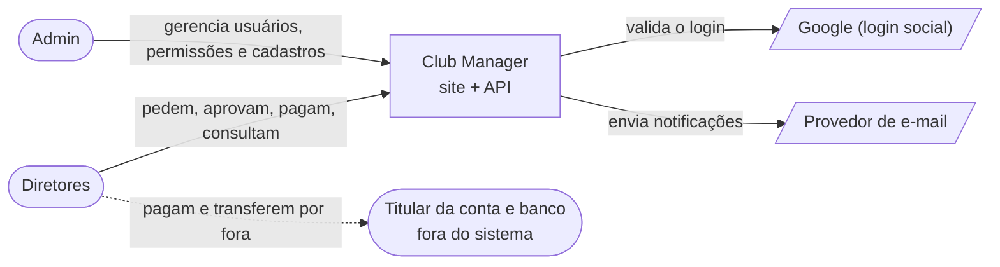
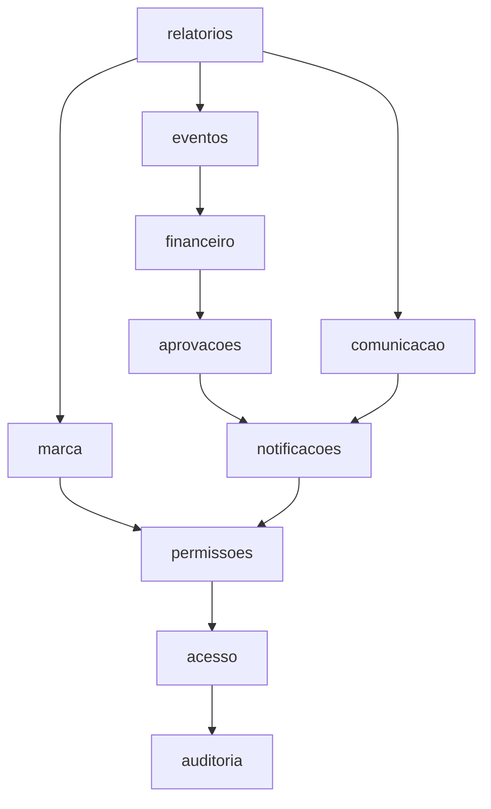

# Plano técnico

Arquitetura, estrutura de pastas, decisões numeradas, estratégia de testes e a tabela de débitos e melhorias
futuras. Complementa a [constituição](00-constitution.md) e a [spec](01-spec.md).

## 1. Arquitetura

### Contexto



O banco e o titular da conta não se integram ao sistema: os valores são escriturais (RN-023).

### Containers

| Container | Responsabilidade | Tecnologia | Decisão |
| --- | --- | --- | --- |
| `web` | Servir o site e repassar `/api` | Caddy 2; React 19, Vite 8, TypeScript 7 | DEC-05 |
| `api` | Toda a regra de negócio, permissões e auditoria | Python 3.14, Django 6.1, DRF 3.18, gunicorn | DEC-01, DEC-04 |
| `worker` | Tarefas agendadas e trabalho em segundo plano | Celery 5.7, mesma imagem da `api` | DEC-06 |
| `db` | Dados; schema só por migrações | PostgreSQL 18 | DEC-04 |
| `redis` | Fila do Celery, sem persistência | Redis 8 | DEC-06 |

O diagrama de containers está no README. Em produção nenhuma porta de banco ou Redis é publicada; em
desenvolvimento, só em `127.0.0.1`.

### Módulos e dependências

Um módulo só importa os que estão abaixo dele, e só pelo `public.py`.



`aprovacoes`, `comunicacao` e `marca` estão no mesmo nível e não se importam. `kernel` (erros, saúde, logs,
despachante de eventos) não conhece nenhum módulo.

| Regra | Como é verificada |
| --- | --- |
| Um módulo só importa os que estão abaixo dele | Contrato `layers` do import-linter (`uv run poe imports`) |
| De outro módulo, só se importa `<modulo>.public` | `tests/test_architecture.py` |
| Todo módulo tem `public.py` | `tests/test_architecture.py` |
| `<modulo>.domain` não importa Django, DRF, Celery nem drf-spectacular | `tests/test_architecture.py` |
| `kernel` não conhece nenhum módulo | `tests/test_architecture.py` |
| Rota sem permissão declarada é negada | Permissão padrão do DRF; teste em `tests/test_errors.py` |
| Não há migração pendente | `uv run poe migrations-check` |

Todas rodam em `uv run poe verify`, na máquina e no CI. Ainda sem verificação automática, conferidas na revisão
de cada feature: views e serializers sem regra de negócio; estado de aggregate alterado só pelos métodos dele;
referência entre módulos por ID, sem chave estrangeira.

### Padrões de integração

- **Permissões.** O módulo declara as suas ao iniciar (`permissoes.public.registrar_permissao`, código
  `<recurso>.<acao>`, que nunca muda de significado) e pergunta com `pode`, `quem_pode` e `le_gestao`. Sem cache:
  a mudança vale na requisição seguinte. Um módulo de baixo que precisa da resposta de um de cima define uma
  porta com padrão seguro, registrada pelo de cima ao iniciar.
- **Notificações.** Módulos acima de `notificacoes` declaram os tipos (`registrar_tipo`) e notificam dentro da
  transação do caso de uso (`notificar`), com uma `chave` que identifica o fato e impede a duplicata. Módulos
  abaixo publicam um evento definido no próprio `public.py` (`kernel.events.publish`), tratado por `notificacoes`
  na mesma transação. Eventos de hoje: `CadastroConcluido`, `PapelDeAdminAlterado`, `ClassificacaoAlterada`,
  `ConcessaoIndividualAlterada`. O e-mail só é enfileirado depois do commit.
- **Motor de aprovações.** O módulo dono de um tipo chama `aprovacoes.public.registrar_tipo(codigo, nome,
  permissao_de_aprovar, tem_valor, preparar, ao_mudar, permissao_de_enviar)`. `preparar` valida e normaliza o
  conteúdo; `ao_mudar` recebe cada mudança, na mesma transação. Só o módulo dono põe em execução e encerra.
- **Depois do commit.** E-mail e trabalho pesado usam `transaction.on_commit`; a tarefa recebe só IDs, nunca um
  token.

## 2. Estrutura de pastas

```text
.
├── compose.yaml              Sobe o sistema inteiro
├── compose.override.yaml     Só em desenvolvimento: expõe portas e sobe o Mailpit
├── .env.example              Variáveis de ambiente, sem valores reais
├── backend/                  API e worker (uma imagem, dois comandos)
│   ├── config/               Configuração do Django, rotas de topo, aplicação Celery
│   ├── kernel/               Base técnica; não conhece nenhum módulo
│   ├── auditoria/ acesso/ permissoes/ notificacoes/ marca/
│   ├── aprovacoes/ comunicacao/ financeiro/ eventos/ relatorios/
│   ├── tests/                Testes da base técnica e de arquitetura
│   └── scripts/              Utilitários de desenvolvimento
├── frontend/src/             api/ (cliente, sem regra), paginas/ (telas), test/
└── docs/sdd/                 Esta documentação
```

Dentro de um módulo (criados quando a primeira feature precisar):

```text
<modulo>/
├── public.py        API pública em processo: o único arquivo que outros módulos importam
├── models.py        Modelos; nos módulos core, os aggregates com os métodos de negócio
├── domain/          Funções de decisão e value objects, sem framework (só nos módulos com regra)
├── services.py      Casos de uso: transação, permissão, aggregate, auditoria
├── http/            Serializers, views e urls; sem regra de negócio
├── handlers.py      Tratadores de eventos de integração de módulos abaixo
├── tasks.py         Tarefas do Celery; só chamam um serviço
├── migrations/      Migrações do Django
└── tests/           Testes do módulo
```

Convenções: chaves primárias UUID v7; rotas sob `/api/v1/`, com recursos e campos em português; erros no envelope
`{"error": {"code", "message", "details"}}`; migrações nomeadas com `--name` descritivo; nenhuma injeção de
dependência (as fronteiras trocam por configuração do Django).

## 3. Stack

| Preocupação | Ferramenta |
| --- | --- |
| Backend | Python 3.14, Django 6.1, DRF 3.18, uv (lockfile versionado), gunicorn, WhiteNoise |
| Banco, fila | PostgreSQL 18; Celery 5.7 e Redis 8 |
| Contrato | drf-spectacular, em `/api/v1/schema/` e `/api/v1/docs/`, só para admin, sem CDN |
| Senhas e sessão | Argon2; sessão do Django no banco, com CSRF |
| Google | `google-auth`, atrás da port `VerificadorGoogle` (fake nos testes) |
| E-mail | SMTP por `EMAIL_URL`; sem ela, sai no log; em desenvolvimento, Mailpit |
| Qualidade do backend | Ruff (com regras `S`), mypy estrito, pytest, pytest-django, pytest-cov, import-linter, pip-audit |
| Site | React 19, React Router 8, Vite 8, TypeScript 7, Vitest, Testing Library, oxlint, Caddy 2 |
| CI | GitHub Actions, um workflow por pasta |

Comandos do dia a dia:

| Para | Comando |
| --- | --- |
| Subir tudo | `docker compose up --build` (na raiz) |
| Subir só banco e Redis, para os testes | `docker compose up -d db redis` |
| Verificação completa do backend | `uv run poe verify` (em `backend/`) |
| Verificação completa do site | `npm run verify` (em `frontend/`) |

## 4. Decisões

Cada decisão registra o que foi escolhido e o que foi descartado. O próximo número é sempre o maior existente + 1.
Só o dono do projeto muda um status para aceito ou resolvido.

O código e os comentários citam `ADR-001` a `ADR-008`; elas correspondem a `DEC-01` a `DEC-08`, na mesma ordem.

| ID | Decisão | Escolhido | Descartado | Status |
| --- | --- | --- | --- | --- |
| DEC-01 | Estilo arquitetural | Monólito modular; DDD tático em `aprovacoes`, `financeiro` e `eventos`; camadas nos demais; fronteira verificada no CI; gatilhos de revisão: dashboard lento (read model só da consulta afetada), segundo cliente real (tenant) | Camadas e ports nas fronteiras, sem DDD; hexagonal completa ou Clean Architecture | Aceita |
| DEC-02 | Repositório e legado | Reaproveitar o repositório; o protótipo antigo fica fora do git, só como consulta, e é removido até o M12 | Repositório novo | Aceita |
| DEC-03 | Integração entre contextos | Para cima, chamada direta à API pública; para baixo, evento de integração em processo, síncrono e na mesma transação; auditoria por chamada direta; adendo: portas de consulta com padrão seguro para módulo de baixo perguntar ao de cima | Só chamadas diretas, aceitando ciclos; eventos assíncronos com outbox | Aceita |
| DEC-04 | Backend | Django 6.1 + DRF 3.18 + PostgreSQL 18 + Python 3.14; views e serializers só validam e formatam; sem `ModelViewSet` nem `ModelSerializer` que gravem direto | FastAPI com Pydantic | Aceita |
| DEC-05 | Site | React 19 + Vite + TypeScript como SPA, atrás do Caddy que repassa `/api`; sem regra de negócio | Next.js | Aceita |
| DEC-06 | Filas e agendamento | Celery com Redis, um worker com agendador embutido, sem backend de resultados, Redis sem persistência; tarefa idempotente que só chama um serviço | Fila no próprio PostgreSQL | Aceita |
| DEC-07 | Repositório, CI e imagens | Um repositório; duas imagens (`club-manager-api`, `club-manager-web`), as mesmas em desenvolvimento e produção; um workflow por pasta; configuração só por variável de ambiente | Dois repositórios; um workflow único que roda tudo sempre | Aceita |
| DEC-08 | Sessão e autenticação | Sessão do Django no banco, cookie `HttpOnly`/`Secure`/`SameSite=Lax` e CSRF, mesma origem; 7 dias sem uso; Google pelo token de identidade validado na API; app futuro com token opaco guardado no servidor | JWT de acesso com token de renovação; biblioteca completa de autenticação social por redirecionamento | Aceita |
| DEC-09 | Permissões | Catálogo de códigos `<recurso>.<acao>` declarados pelos módulos; concessão por cargo, setor ou usuário; permissão efetiva é a união; acesso total não inclui auto-aprovação | Escopo por setor do item | Aceita |
| DEC-10 | Motor de aprovações | Um aprovador por versão; o que exige duas decisões são duas solicitações ligadas; versões e decisões imutáveis, também no banco; tipos se registram no motor | Aprovação por vários setores na mesma solicitação | Aceita |
| DEC-11 | Auditoria | Registro só de inserção, na mesma transação, com gatilho no banco que recusa `UPDATE` e `DELETE`; guarda só IDs | — | Aceita |
| DEC-12 | Primeiro admin | Comando `criar_admin` que lê a senha sem ecoar e não a aceita por argumento; nenhuma senha padrão | Senha ou usuário padrão | Aceita |
| DEC-13 | Estornos e cancelamentos | Lançamento novo ligado ao original; estado final imutável | Edição do registro | Pendente (M7) |
| DEC-14 | Armazenamento de anexos | Abstração `STORAGES` do Django; provedor de custo mínimo, trocável por configuração | — | Pendente (M6) |
| DEC-15 | Provedor de e-mail | SMTP genérico por configuração; escolha do provedor na produção | — | Não bloqueia (M12) |
| DEC-16 | CI/CD, deploy e dimensionamento | CI no plano gratuito do GitHub Actions; deploy, HTTPS, backup e rollback na instância única | — | Pendente (M12) |
| DEC-17 | Aplicativo mobile | Fora da etapa 1; comparar tecnologias na fase própria | — | Adiada |
| DEC-18 | Multi-cliente | Fora da etapa 1; nenhuma identidade de clube fixa no código | Coluna de cliente agora | Adiada |

## 5. Estratégia de testes

| Camada | Como | Onde |
| --- | --- | --- |
| Funções de decisão e value objects | Unitários, sem banco e sem framework; tabela de transições testada inteira | `<modulo>/tests/` |
| Casos de uso e aggregates | Integração com o PostgreSQL real (sem SQLite); toda invariante tocada tem teste | `<modulo>/tests/` |
| Rotas | `APIClient` do DRF; ordem de conferência verificada (leitura, entrada, existência, quem pode, situação); acesso negado a anexo | `<modulo>/tests/` |
| Arquitetura | Fronteiras de módulo, `domain` sem framework, `public.py` obrigatório, migrações pendentes | `backend/tests/`, `poe imports`, `poe migrations-check` |
| Tarefas agendadas | Cada tarefa roda duas vezes e não duplica efeito; nos testes, rodam na hora, sem worker | `<modulo>/tests/` |
| Site | Vitest e Testing Library, com a API simulada; nenhum teste de regra de negócio | `frontend/src/**/*.test.tsx` |
| Fluxos críticos | Aprovação, validação, permissões e recorrência com teste de ponta a ponta (RNF-14), a consolidar no M12 | CI |
| Sistema no ar | Subir os contêineres e percorrer o fluxo antes de fechar um marco; o CI não faz isso | Manual, com evidência |

Regras: banco real nos testes de integração; fakes só em fronteiras reais (e-mail, armazenamento, Google); sem rede
real em testes unitários; hash de senha de custo mínimo nos testes. Cobertura mínima de 80%, com ramos, no backend
e no site.

Verificação completa, a mesma na máquina e no CI:

- backend: formato, lint, tipos, fronteiras de módulo, migrações pendentes, testes com cobertura e `pip-audit`;
- site: lint, tipos, testes com cobertura, build e `npm audit --audit-level=high`.

Os dois conjuntos não rodam ao mesmo tempo na mesma máquina: os testes do site ficam instáveis. No Windows, os
comandos do site rodam num terminal aberto em `C:\…` com a letra maiúscula, e o banco e o Redis de desenvolvimento
são acessados por `127.0.0.1`, porque `localhost` tenta IPv6 primeiro.

## 6. Riscos técnicos

| # | Risco | Status |
| --- | --- | --- |
| 1 | API, banco, fila e worker não cabem com folga na instância única | Pendente de análise; medir no M1 e no M12 |
| 2 | As regras do free tier da AWS para a conta do dono diferem do que se supõe | Pendente de análise |
| 3 | O Pix copia e cola gerado sem integração bancária não é aceito por algum aplicativo de banco | Pendente; testar com aplicativos reais no M6 |
| 4 | Um tratador de evento em processo com erro desfaz a operação de quem publicou | Mitigado: tratadores curtos e testados |
| 5 | A tarefa de geração de cobranças roda duas vezes e duplica cobranças | Mitigado: unicidade por recorrência, devedor e competência |
| 6 | Geração de PDF pesa na instância pequena | Pendente; escolher a biblioteca no M10 |
| 7 | E-mails caem em spam ou o provedor gratuito limita o envio | Pendente |
| 8 | "Nada é apagado" entra em conflito com direitos do titular na LGPD | Pendente; ver [04-seguranca](04-seguranca.md) |
| 9 | O escopo do M6 cresceu com inadimplência, renegociação, suspensão e Pix | Mitigado: o M6 é dividido em seis features |
| 10 | Em desenvolvimento, os links dos e-mails saem quebrados no log | Mitigado: Mailpit no compose de desenvolvimento |

## 7. Débitos e melhorias futuras

Débito é desvio que já existe no código; melhoria é evolução deixada fora do escopo atual, com o gatilho para
retomar. Uma decisão em aberto que bloqueia trabalho fica na tabela da seção 4, não aqui.

| ID | Item | Tipo | Por que ficou fora | Gatilho para retomar | Status |
| --- | --- | --- | --- | --- | --- |
| D-01 | Contrato e documentação da API abertos e dependentes de CDN | Débito | Não havia autenticação no M1 | — | Resolvido no M2: rotas só para admin e arquivos da página servidos pela imagem |
| D-02 | Login com o Google exercitado só com fake | Débito | Depende do ID de cliente do dono | Configurar o Google Cloud antes da produção | Aberto |
| D-03 | DAST não executado | Débito | Sem ferramenta escolhida | Avaliar no M12, guiado pelo contrato | Aberto |
| D-04 | Aplicativo mobile, com push e caixa de entrada | Melhoria | Só depois de o site estar completo | M12 concluído e novo enunciado de fase | Futuro |
| D-05 | Torcedor e jogador, com cadastro aberto | Melhoria | A etapa 1 é só para diretores | Novo enunciado de fase | Futuro |
| D-06 | Gestão do time como um todo | Melhoria | Além da governança financeira e institucional | Novo enunciado de fase | Futuro |
| D-07 | Multi-cliente: deploy por cliente ou SaaS | Melhoria | Só se decide ao escalar | Segundo cliente real | Futuro |
| D-08 | Recebimento automático por plataforma de pagamento | Melhoria | Valores escriturais; só o ponto de extensão | Decisão do dono de integrar | Futuro |
| D-09 | Importação de CSV | Melhoria | Não prevista | Pedido do dono | Futuro |
| D-10 | Aprovação da mesma solicitação por dois ou mais setores | Melhoria | Um aprovador por solicitação; casos com duas decisões são solicitações ligadas | Primeiro caso real que não caiba em solicitações ligadas | Futuro |
| D-11 | Votação de diretores para decidir questionamentos ou dívidas | Melhoria | Decide quem tem a permissão | Pedido do dono | Futuro |
| D-12 | Confirmação, no sistema, de quem recebeu dinheiro em mão | Melhoria | O validador consulta por fora | Disputa sobre um recebimento em mão | Futuro |
| D-13 | Confirmação do admin antes de uma indicação de aprovador valer | Melhoria | Basta histórico e aviso ao admin | Abuso da indicação | Futuro |
| D-14 | Pagamento parcial de uma cobrança; juros e multa em cobrança atrasada | Melhoria | Não pedidos; a renegociação em parcelas cobre o caso | Pedido do dono no M6 | Futuro |
| D-15 | Envio do recurso em mais de uma transferência; bloquear novos pedidos de quem tem prestação atrasada; reembolso sem pedido prévio | Melhoria | Não pedidos | Pedido do dono no M7 | Futuro |
| D-16 | Comentários e reações no feed; pastas e acesso restrito por cargo nos documentos | Melhoria | "A definir" no enunciado | Refinamento do M9 | Futuro |
| D-17 | Evento recorrente; lista de presença; lembrete a quem confirmou; aprovação diferente por categoria | Melhoria | Fora do mínimo escolhido | Pedido do dono no M8 | Futuro |
| D-18 | Notificações em tempo real; preferência por tipo; resumo diário por e-mail | Melhoria | Escolhidas a consulta a cada minuto e uma chave só | Pedido do dono | Futuro |
| D-19 | Prazos de lembrete configuráveis; trocar o aprovador indicado depois do envio; avisar o admin quando o indicado é desativado | Melhoria | Prazos fixos e o aviso dos 7 dias ao admin bastam | Pedido do dono | Futuro |
